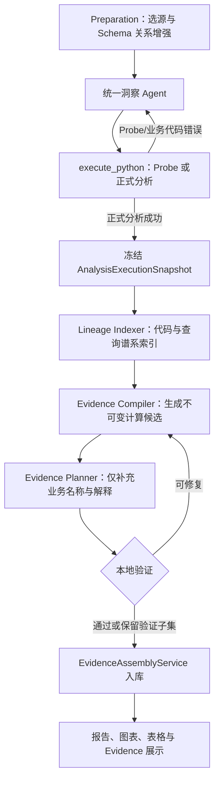

# 后置 Evidence 架构设计

## 1. 设计结论

实现基线固定为提交 `8014437`。正式洞察分析继续由一个统一 Agent 完整拥有查询、
计算、图表、表格和报告表达。Evidence 从正式 Python 代码的生成契约中移除，在正式
分析成功并冻结后，由独立的后置编译链根据真实代码、查询快照和最终产物生成。

这不是再设计一套 Metric/Evidence Runtime API。正式 Agent 不创建 Metric 对象，
不手写 EvidenceDefinition、evidence key、MetricTrace 或 artifact trace refs，也不会
因为 Evidence 错误重写已经正确的业务代码和报告。

## 2. 基线问题与代码事实

当前基线把 Evidence 放在统一 Agent 的主职责内：

1. `sys_prompt.md` 要求模型同时生成 `evidence_definitions`、
   `metric_evidence_bindings`、报告 trace 标签和 refs。
2. `save_analysis_result(...)` 同时接收分析产物和 Evidence 草稿。
3. `execute_python(...)` 在正式代码成功执行后调用 `_validate_evidence_contract(...)`；
   Evidence/ref 错误会把整个 execution 标记为失败，并要求模型重写完整代码。
4. `EvidenceAssemblyService` 本身已是后置入库组件，但它只组装模型预先写好的草稿，
   不负责从真实执行事实编译 Evidence。
5. `QuerySnapshot` 已是与数据源类型无关的查询事实协议：约束校验记录逻辑范围，真实
   loader 记录实现、执行状态、返回字段和规模。后置编译直接消费该协议，不要求模型
   再次描述 SQL、文件读取、时序查询、数据源和过滤条件。

Evidence 功能引入后，`sys_prompt.md` 相比引入前增加了约 1.6 万字符。更重要的是，
Evidence 规则与报告、查询、图表规范交织，模型需要一边完成洞察分析，一边维护大量
机械绑定关系。错误反馈又会进入同一个 ReAct 修复上下文，容易让后续尝试删减报告
数值、图表或分析内容来通过契约。

## 3. 设计原则

### 3.1 洞察结果先完成并冻结

正式分析成功的判定只依赖：

- Python 代码可执行；
- 查询约束、数据访问和数据质量契约通过；
- 报告、图表、表格产物合法；
- 结果回答用户问题。

正式成功后生成不可变 `AnalysisExecutionSnapshot`。后续 Evidence 处理不能修改查询、
计算公式、图表数据、表格数据或 Markdown。

### 3.2 Evidence 只解释已经发生的计算

Evidence 编译器没有洞察规划权。它只能回答：

- 这个可点击位置对应代码里的哪一个计算结果；
- 该结果来自哪些已注册查询；
- 经历了哪些过滤、聚合、公式、排序或展示变换；
- 当前点击位置如何从 grouped 结果中定位。

找不到可验证链路时，不得猜测或绑定一个主题相近的 Evidence。

### 3.3 不扫描 Markdown 数字反推指标

系统不使用正则或数值相等关系扫描 Markdown，再猜测某个数字属于哪个指标。
报告绑定由“代码表达式锚点 + 最终文本精确片段”共同定位。文本只用于确认最终字符
区间，不用于决定计算语义。

### 3.4 一个计算签名对应一个 Evidence

本地编译器根据真实查询和代码操作生成 `calculation_signature`：

```text
query refs
+ filters
+ grouping
+ aggregation or formula
+ ordering/window/selection
```

- 相同签名在报告、图表、表格中复用同一 Evidence。
- 不同签名永远生成不同 Evidence，不能因业务名称相似而合并。
- grouped 计算按指标列形成一个 Evidence，各点或各行由 selector 定位。
- 比率、差额、增长率、Top/Min/Max 等派生计算拥有独立签名。

### 3.5 Evidence 失败不推翻分析成功

Evidence 具有独立状态：`pending / complete / partial / failed`。编译失败最多进行一次
Evidence 专用修复，不重新调用正式分析 Agent。最终只持久化通过本地验证的 refs；
未验证位置不可点击，但分析报告和其他产物仍正常展示。

首版将最终编译状态和诊断写入 `insight_ns_execution_evidence`。正式分析、消息和 artifacts
先提交，Evidence 在后续独立事务中组装；Evidence 调用或入库异常不会回滚成功分析。

## 4. 目标流程



统一 Agent 的 ReAct 上下文只处理 Probe、业务计算和产物修复。Evidence Planner 使用
独立、较小的上下文，不继承历史失败消息，也不向统一 Agent 回传 Evidence 错误。

## 5. 核心产物

### 5.1 AnalysisExecutionSnapshot

正式执行成功后由后端生成，不由 LLM 编写：

```json
{
  "execution_id": 123,
  "code_hash": "...",
  "result_hash": "...",
  "generated_code": "...",
  "query_snapshots": {},
  "selected_datasource_snapshot": [],
  "analysis_report": "...",
  "charts": [],
  "tables": []
}
```

快照必须对应同一次成功 execution。代码、查询快照和产物 hash 不一致时停止 Evidence
编译，不能跨 execution 拼接事实。

### 5.2 LineageIndex

由本地解析器从快照构建：

- `query_nodes`：来自已有 `query_snapshots`；
- `operation_nodes`：Python AST 中的过滤、分组、聚合、算术、排序、窗口和选择；
- `source_field_nodes`：由 QuerySnapshot 的真实返回字段形成的数据源无关字段节点；
- `sql_expression_nodes`：关系型 SQL 可解析时补充的 SELECT、WHERE、GROUP BY、聚合和表达式；
- `output_nodes`：图表数值字段、表格业务数值列、报告动态表达式；
- `edges`：变量赋值、列派生、查询到 DataFrame、操作到最终产物的依赖。

所有节点使用由源码位置和规范化表达式生成的稳定 ID。Python 使用标准 AST；SQL 使用
结构化 parser 提升关系查询的粒度，但不是 Evidence 成立的前提。文件、时序和外层
`SELECT *` 等场景统一从 QuerySnapshot 的 loader 身份与 `execution.columns` 建立字段
血缘。禁止用字符串包含关系判断公式或字段语义。

首批必须覆盖项目最常见的计算语法：

- SQL 查询、JOIN、过滤、GROUP BY 和常见聚合；
- pandas 过滤、`groupby/agg`、`sum/mean/count/nunique/min/max`、`value_counts`；
- 列运算、比率、差额、增长率；
- `sort_values`、`head/tail`、Top/Min/Max；
- 图表 value field、表格 column、报告 f-string/format 动态值。

不支持的自定义算法节点标记为 `unresolved`，不得降级为主题相似匹配。

### 5.3 CalculationCandidate 与 EvidencePlan

Compiler 先按唯一计算边界和查询范围生成不可变 `calculation_id`。只有边界唯一、查询来源完整的产物位置才形成候选；存在多个可能边界时保持 unresolved，不做名称或数值猜测。

Evidence Planner 是一个专注于“阅读已完成分析”的 LLM 调用，只为每个候选补充业务语义：

```json
{
  "metrics": [
    {
      "calculation_id": "calc_...",
      "metric_key": "annual_contract_amount",
      "business_name": "年费合同金额",
      "value_type": "currency",
      "display_unit": "元",
      "business_explanation": "目标范围内年费合同金额的合计"
    }
  ]
}
```

Planner 不能选择、合并或拆分计算边界，也不能提交 SQL、代码、字符区间、Evidence ID 或
计算结果。查询、计算、产物位置和 ref 均由本地 Compiler 生成。业务说明不得出现 Runtime、Metric、
Report Program、字段 API 等内部术语。

### 5.4 EvidenceBundle

Compiler 将通过验证的 Plan 编译为现有前端可消费的结构：

- `evidence_map`；
- `chart_trace_refs`；
- `table_trace_refs`；
- `report_trace_refs`；
- `query_snapshots`。

因此前端点击协议和 `/evidence/resolve` 接口原则上不需要重构，只调整 Evidence 的生产
来源。`evidence_key` 和 `evidence_id` 都由本地签名生成，不由 LLM 命名决定身份。

## 6. 三类产物的绑定规则

### 6.1 图表

图表 helper 在标准化时将 `chart_document.encoding` 保留为轻量 `chart_data_contract`，不复制数据集。后置编译从该结构获得数值字段，不从 ECharts 展示 JSON 反推。一个 value field 对应一个计算签名；
同字段下所有点共享 Evidence，并通过图表维度值形成 selector。不能按数据点生成
Evidence。

### 6.2 表格

表格按业务数值列绑定，不按单元格生成 Evidence。已有 `build_table_result(...)` 的列
角色元数据可以保留为产物描述能力，但不再要求模型写 evidence binding。每一行点击时
使用行维度形成 selector，当前值直接来自该单元格，不存入 EvidenceDefinition。

### 6.3 报告

Compiler 从 Python AST 提取动态字符串的结构模板、源码表达式、格式化槽位和邻接静态
文本，再与最终 Markdown 做整段模板匹配，精确定位 `start/end`。最终文本只确认某个
已知代码槽位渲染到了哪里，不参与发现指标或决定计算边界。动态精度、预格式化百分比
和同一模板内多个数值槽位均按各自表达式回溯。

如果同一文本出现多次，必须由源码锚点、邻接静态文本和出现顺序共同消歧。无法唯一
定位时不生成 ref，不能依靠数值相等绑定。

## 7. 单位与当前值

EvidenceDefinition 解释计算口径，不保存某个图表点或表格单元格的当前值。点击时：

- 图表当前值来自所选数据点；
- 表格当前值来自所选行列；
- 报告当前值来自 ref 对应的 render event；
- grouped selector 只定位成员，不复制 Evidence。

计算单位与展示单位分离保存，展示单位不参与计算签名。百分比、万元、千件等展示换算
记录在具体 artifact ref 上，例如 `scale=100`、`suffix="%"`、`precision=2`，不能修改
原始计算值；同一计算以不同展示单位出现在图表、表格或报告时仍复用同一 Evidence。

## 8. 校验边界

本地强校验只检查可确定事实：

1. code/result hash 与 execution 一致；
2. 每个 `calculation_id` 由本地唯一边界生成，Planner 只能逐项补充语义且不得遗漏；
3. query 节点来自本次 `query_snapshots`；
4. output node 确实到达对应产物位置；
5. 一个 calculation signature 只生成一个 Evidence；
6. 不同 signature 不共享 Evidence；
7. ref 指向真实图表字段、表格列或报告字符区间；
8. selector 与产物维度一致；
9. 展示变换可以从执行事件或代码表达式验证。

以下内容不做刚性文本校验：报告章节数、段落数、最低字数、Markdown 中全部数字覆盖率。
报告质量仍由统一 Agent 的角色和完整洞察语义保证。

## 9. 与现有代码的切换边界

### 保留

- `validate_query_constraints(...)` 和自动 `query_snapshots`；
- 正式分析、Probe、No Data、代码修复的统一 ReAct 上下文；
- `InsightNsExecutionEvidence`、Artifact metadata、Evidence resolve 接口；
- `EvidenceAssemblyService` 的 ID 解析、source refs 和入库职责；
- 前端现有 artifact/evidence 点击协议。

### 移出正式 Agent

- `define_evidence(...)`；
- `metric_evidence_bindings`；
- 手写 `chart_trace_refs` / `table_trace_refs` / `report_trace_refs`；
- 报告 `[[trace:...]]` 标签和 `build_report_result(...)`；
- Evidence 示例、规则和 Evidence 专用修复提示；
- `_validate_evidence_contract(...)` 对正式 execution 成功状态的阻断。

### 最终删除

后置路径达到验收门槛后，删除正式代码中上述旧入口和兼容分支。开发期间允许旁路对比，
但最终生产只有一条 canonical 后置 Evidence 路径。

## 10. 落地计划

### 阶段一：冻结行为与建立快照

1. 固定综合分析、问数、分组图表、结构化表格、比率、TopN、无数据和本地重执行样本。
2. 为当前成功 execution 增加不可变快照构造和 hash 测试。
3. 记录基线报告质量、正式代码重试次数、Prompt 大小和 Evidence 错误率。

### 阶段二：Lineage Indexer

1. 实现 Python AST 和 SQL AST 索引。
2. 建立查询、变量、列、操作和输出节点关系。
3. 增加报告 render event 的透明采集，不改变最终字符串。
4. 用手写代码夹具验证常见计算签名和 grouped selector。

### 阶段三：Evidence Planner 与 Compiler

1. 定义严格 JSON schema 和专用 Prompt。
2. Compiler 先生成不可变计算候选，Planner 只做业务命名和解释。
3. Compiler 生成 signature、EvidenceDefinition 和三类 refs。
4. 实现一次 Evidence 专用结构化修复；保留验证子集，不回流正式 Agent。

### 阶段四：旁路真实回归

1. 正式结果仍按基线生成，后置链只记录对比结果，不影响展示。
2. 对比旧 Evidence 与后置 Evidence 的正确率、覆盖率、耗时和上下文大小。
3. 人工逐项核验报告、图表、表格点击值、单位、查询和计算说明。

### 阶段五：原子切换

1. 从正式 Prompt 和 `save_analysis_result(...)` 生成契约中移除 Evidence。
2. 正式 execution 通过业务契约后立即成功，不再执行 Evidence 阻断校验。
3. 在 artifact 创建后运行后置 Evidence 编译和 Assembly。
4. 本地重执行复用同一后置入口。
5. 删除旧 helper、旧参数、旧验证和兼容路径。

## 11. 验收门槛

只有同时满足以下条件才切换：

- 同一计算签名跨报告、图表和表格稳定复用同一 Evidence；
- 不同计算签名的误共享为 0；
- ref 绑定不相关 Evidence 为 0；
- grouped 指标不按点或单元格复制 Evidence；
- 当前值、单位、百分比和展示换算与产物一致；
- Evidence 说明使用业务语言，技术谱系可审计；
- Evidence 错误不会增加正式 Python 代码重试；
- 正式 Prompt 明显缩小，报告表达力不低于切换前及原版样本；
- 本地重执行、刷新、追问、无数据和取消流程不回退；
- 总耗时增加可测且可接受，Evidence 超时不阻塞分析结果展示。

若 Lineage Indexer 无法覆盖常见生成代码，或必须依赖 Markdown 数字猜测才能达到覆盖率，
则停止切换并补足编译能力，不能用 Prompt 禁止项约束统一 Agent 的洞察表达。
