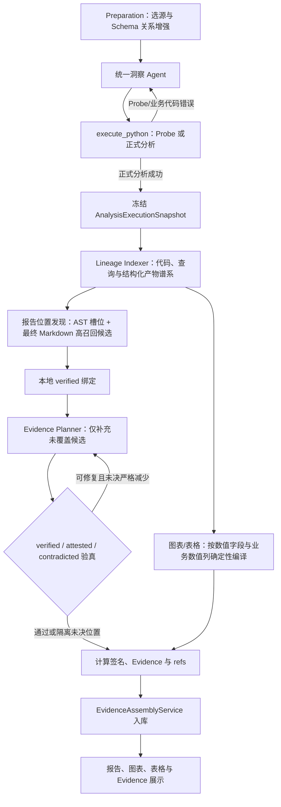

# 后置 Evidence 架构设计

## 1. 设计结论

实现基线固定为提交 `8014437`。正式洞察分析继续由一个统一 Agent 完整拥有查询、
计算、图表、表格和报告表达。Evidence 从正式 Python 代码的生成契约中移除，在正式
分析成功并冻结后，由独立的后置编译链根据真实代码、查询快照和最终产物生成。

这不是再设计一套 Metric/Evidence Runtime API。正式 Agent 不创建 Metric 对象，
不手写 EvidenceDefinition、evidence key、MetricTrace 或 artifact trace refs，也不会
因为 Evidence 错误重写已经正确的业务代码和报告。

## 2. 基线问题与代码事实

当前基线把 Evidence 放在统一 Agent 的主职责内：

1. `sys_prompt.md` 要求模型同时生成 `evidence_definitions`、
   `metric_evidence_bindings`、报告 trace 标签和 refs。
2. `save_analysis_result(...)` 同时接收分析产物和 Evidence 草稿。
3. `execute_python(...)` 在正式代码成功执行后调用 `_validate_evidence_contract(...)`；
   Evidence/ref 错误会把整个 execution 标记为失败，并要求模型重写完整代码。
4. `EvidenceAssemblyService` 本身已是后置入库组件，但它只组装模型预先写好的草稿，
   不负责从真实执行事实编译 Evidence。
5. `QuerySnapshot` 已是与数据源类型无关的查询事实协议：约束校验记录逻辑范围，真实
   loader 记录实现、执行状态、返回字段和规模。后置编译直接消费该协议，不要求模型
   再次描述 SQL、文件读取、时序查询、数据源和过滤条件。

Evidence 功能引入后，`sys_prompt.md` 相比引入前增加了约 1.6 万字符。更重要的是，
Evidence 规则与报告、查询、图表规范交织，模型需要一边完成洞察分析，一边维护大量
机械绑定关系。错误反馈又会进入同一个 ReAct 修复上下文，容易让后续尝试删减报告
数值、图表或分析内容来通过契约。

## 3. 设计原则

### 3.1 洞察结果先完成并冻结

正式分析成功的判定只依赖：

- Python 代码可执行；
- 查询约束、数据访问和数据质量契约通过；
- 报告、图表、表格产物合法；
- 结果回答用户问题。

正式成功后生成不可变 `AnalysisExecutionSnapshot`。后续 Evidence 处理不能修改查询、
计算公式、图表数据、表格数据或 Markdown。

### 3.2 Evidence 只解释已经发生的计算

Evidence 编译器没有洞察规划权。它只能回答：

- 这个可点击位置对应代码里的哪一个计算结果；
- 该结果来自哪些已注册查询；
- 经历了哪些过滤、聚合、公式、排序或展示变换；
- 当前点击位置如何从 grouped 结果中定位。

找不到可验证链路时，不得猜测或绑定一个主题相近的 Evidence。

### 3.3 最终报告扫描只发现位置，不反推指标

系统以高召回方式扫描最终 Markdown 的潜在数值位置，保证 AST 未覆盖的新语法、动态
文本和紧邻中文量词的数值不会静默遗漏。扫描结果只是包含 `report_candidate_id`、
`start/end` 和 `text` 的候选，不能直接创建 Evidence，也不能通过数值相等、字段名相似
或主题相似猜测指标。

年份、日期、Markdown 列表序号、比较阈值、公式系数和业务编码等展示数字由确定性语法
规则排除。候选的计算语义仍必须由代码表达式、AST/dataflow、LLM 结构化声明和
QuerySnapshot 联合确定；最终文本只提供真实位置和必要的局部展示上下文。

### 3.4 一个计算签名对应一个 Evidence

本地编译器根据真实查询和代码操作生成 `calculation_signature`：

```text
query refs
+ filters
+ grouping
+ aggregation or formula
+ ordering/window/selection
```

- 相同签名在报告、图表、表格中复用同一 Evidence。
- 不同签名永远生成不同 Evidence，不能因业务名称相似而合并。
- grouped 计算按指标列形成一个 Evidence，各点或各行由 selector 定位。
- 比率、差额、增长率、Top/Min/Max 等派生计算拥有独立签名。

### 3.5 Evidence 失败不推翻分析成功

Evidence 具有独立状态：`pending / complete / partial / failed`。编译失败最多进行一次
Evidence 专用修复，不重新调用正式分析 Agent。最终只持久化通过本地验证的 refs；
未验证位置不可点击，但分析报告和其他产物仍正常展示。

首版将最终编译状态和诊断写入 `insight_ns_execution_evidence`。正式分析、消息和 artifacts
先提交，Evidence 在后续独立事务中组装；Evidence 调用或入库异常不会回滚成功分析。

## 4. 目标流程



统一 Agent 的 ReAct 上下文只处理 Probe、业务计算和产物修复。Evidence Planner 使用
独立、较小的上下文，不继承历史失败消息，也不向统一 Agent 回传 Evidence 错误。

## 5. 核心产物

### 5.1 AnalysisExecutionSnapshot

正式执行成功后由后端生成，不由 LLM 编写：

```json
{
  "execution_id": 123,
  "code_hash": "...",
  "result_hash": "...",
  "generated_code": "...",
  "query_snapshots": {},
  "selected_datasource_snapshot": [],
  "analysis_report": "...",
  "charts": [],
  "tables": []
}
```

快照必须对应同一次成功 execution。代码、查询快照和产物 hash 不一致时停止 Evidence
编译，不能跨 execution 拼接事实。

### 5.2 LineageIndex

由本地解析器从快照构建：

- `query_nodes`：来自已有 `query_snapshots`；
- `operation_nodes`：Python AST 中的过滤、分组、聚合、算术、排序、窗口和选择；
- `source_field_nodes`：由 QuerySnapshot 的真实返回字段形成的数据源无关字段节点；
- `sql_expression_nodes`：关系型 SQL 可解析时补充的 SELECT、WHERE、GROUP BY、聚合和表达式；
- `output_nodes`：图表数值字段、表格业务数值列、报告动态表达式；
- `edges`：变量赋值、列派生、查询到 DataFrame、操作到最终产物的依赖。

所有节点使用由源码位置和规范化表达式生成的稳定 ID。Python 使用标准 AST；SQL 使用
结构化 parser 提升关系查询的粒度，但不是 Evidence 成立的前提。文件、时序和外层
`SELECT *` 等场景统一从 QuerySnapshot 的 loader 身份与 `execution.columns` 建立字段
血缘。禁止用字符串包含关系判断公式或字段语义。

首批必须覆盖项目最常见的计算语法：

- SQL 查询、JOIN、过滤、GROUP BY 和常见聚合；
- pandas 过滤、`groupby/agg`、`sum/mean/count/nunique/min/max`、`value_counts`；
- 列运算、比率、差额、增长率；
- `sort_values`、`head/tail`、Top/Min/Max；
- 图表 value field、表格 column、报告 f-string/format 动态值。

AST 不理解业务语义的赋值语句仍登记为静态代码节点，保留源码位置、目标变量和依赖变量。
Evidence Planner 可以根据完整 Python 代码识别其业务含义；本地验证器只在该节点能够沿变量依赖
到达本轮成功 QuerySnapshot 时接受绑定。无法建立静态事实路径的结果标记为 `unresolved`，不得
降级为主题相似匹配。

### 5.3 Report Semantic Scope 与 EvidencePlan

图表和表格仍由 Compiler 按结构化字段确定性生成计算候选。报告采用“位置高召回、AST
主导绑定、LLM 语义补漏”边界：Compiler 先用本轮真实 query、静态代码操作目录、报告
语法锚点和 AST 血缘绑定所有已证明的报告数值；同时扫描最终 Markdown，补齐 AST 未定位
到的潜在数值位置。Planner 只处理本地尚未覆盖或语义边界仍需判断的候选。语法锚点和
渲染候选都是待验真的位置目录，不是要求 Planner 全量重判的指标结论。

Evidence Planner 是一个专注于“阅读已完成分析代码并补足语义缺口”的 LLM 调用。它以完整
Python 代码为主要事实，并接收尚未解决的候选 ID、局部展示上下文、源码锚点、operation
目录和成功 QuerySnapshot 字段目录。它识别 AST 未能稳定恢复的报告指标、重复展示、计算
边界和所用 operation，但不能根据候选数值相等关系猜测绑定，也不接收完整图表或表格数据集。
Planner 优先引用本地提供的稳定语法锚点；当本地锚点目录漏掉合法报告表达式时，可以提交
源码行与表达式作为补发现锚点，由本地重新解析和验真：

```json
{
  "metrics": [
    {
      "calculation_id": "report_semantic_scope",
      "source_anchors": [{"anchor_id": "expr_...", "line": 120, "expression": "total_amount"}],
      "operation_node_ids": ["op_..."],
      "metric_key": "annual_contract_amount",
      "business_name": "年费合同金额",
      "value_type": "currency",
      "display_unit": "元",
      "business_explanation": "目标范围内年费合同金额的合计"
    }
  ]
}
```

Planner 可以在报告语义作用域内选择、合并或拆分补漏指标。AST 已证明的报告数值不依赖
Planner 覆盖；Planner 对补漏槽位的遗漏或未知 unresolved 不会推翻本地已证明绑定。Planner
不能提交 SQL、字符区间、Evidence ID 或计算结果。本地验证器先将补发现锚点解析为真实 AST
节点，再逐指标检查 `source anchor -> operation -> query` 可达性；最终 query refs 由所选
operation 的 QuerySnapshot 闭包确定。越界操作被剔除，无法证明的槽位单独进入 unresolved，
不会清空其他合法绑定。最终 output node、calculation signature、Evidence ID 和 ref 均由
Compiler 生成。

### 5.3.1 结构化产物的语义补漏边界

图表和表格的可点击位置始终由产物结构确定：图表按数值字段，表格按业务数值列，
不由 LLM 扫描数据点或单元格。计算血缘采用两级解析：

1. 本地 AST/dataflow 编译器优先解析字段到 Python 计算、QuerySnapshot 的完整路径；
2. 仅当某个已确定的结构化数值槽位无法形成唯一计算边界时，调用一次独立的
   Structured Evidence Resolver；
3. Resolver 只接收 unresolved 槽位目录、成功 Python 代码和精简查询字段目录，
   不接收完整图表/表格数据，也不能增加或修改分析产物；
4. Resolver 返回 `output_node_id`、精确源码位置、查询声明和真实字段声明；
5. 本地重新解析源码位置，并用 QuerySnapshot、变量依赖图和查询可达字段验真。
   不存在的查询、字段或相互矛盾的声明进入 `unresolved`，不能生成 Evidence；
6. 通过验真的恢复结果仍由本地生成 calculation signature、EvidenceDefinition 和 ref。

因此，结构化产物不依赖 LLM 决定“哪里可以点击”，同时也不会因为本地尚未覆盖某种
等价 Python 写法而永久漏掉 Evidence。确定性快路径不触发额外 LLM 调用，只有真实的
本地解析缺口才进入补漏路径。

### 5.4 EvidenceBundle

Compiler 将通过验证的 Plan 编译为现有前端可消费的结构：

- `evidence_map`；
- `chart_trace_refs`；
- `table_trace_refs`；
- `report_trace_refs`；
- `query_snapshots`。

因此前端点击协议和 `/evidence/resolve` 接口原则上不需要重构，只调整 Evidence 的生产
来源。`evidence_key` 和 `evidence_id` 都由本地签名生成，不由 LLM 命名决定身份。

## 6. 三类产物的绑定规则

### 6.1 图表

图表 helper 在标准化时将 `chart_document.encoding` 保留为轻量 `chart_data_contract`，不复制数据集。后置编译从该结构获得数值字段，不从 ECharts 展示 JSON 反推。一个 value field 对应一个计算签名；
同字段下所有点共享 Evidence，并通过图表维度值形成 selector。不能按数据点生成
Evidence。

### 6.2 表格

表格按业务数值列绑定，不按单元格生成 Evidence。已有 `build_table_result(...)` 的列
角色元数据可以保留为产物描述能力，但不再要求模型写 evidence binding。每一行点击时
使用行维度形成 selector，当前值直接来自该单元格，不存入 EvidenceDefinition。

### 6.3 报告

Compiler 从 Python AST 提取动态字符串的结构模板、源码表达式、格式化槽位和邻接静态
文本，再与最终 Markdown 做整段模板匹配，精确定位 `start/end`。对 AST 模板未定位的
数值，最终报告扫描器以高召回方式补充位置候选，包括 `共81批`、`温度2次` 等紧邻中文
文本的表达。扫描不决定指标语义；候选只有在本地血缘证明或 LLM 声明通过验真后才能生成 ref。
动态精度、预格式化百分比和同一模板内多个数值槽位均按各自表达式回溯。

如果同一文本出现多次，必须由源码锚点、邻接静态文本和出现顺序共同消歧。无法唯一
定位时不生成 ref，不能依靠数值相等绑定。

## 7. 单位与当前值

EvidenceDefinition 解释计算口径，不保存某个图表点或表格单元格的当前值。点击时：

- 图表当前值来自所选数据点；
- 表格当前值来自所选行列；
- 报告当前值来自 ref 对应的 render event；
- grouped selector 只定位成员，不复制 Evidence。

计算单位与展示单位分离保存，展示单位不参与计算签名。百分比、万元、千件等展示换算
记录在具体 artifact ref 上，例如 `scale=100`、`suffix="%"`、`precision=2`，不能修改
原始计算值；同一计算以不同展示单位出现在图表、表格或报告时仍复用同一 Evidence。

## 8. 校验边界

本地强校验只检查可确定事实：

1. code/result hash 与 execution 一致；
2. 图表/表格 calculation 由本地唯一边界生成；报告数值优先由 AST 与 QuerySnapshot 绑定，
   Planner 只补充无法由 AST 独立覆盖的真实节点；
3. query 节点来自本次 `query_snapshots`；
4. output node 确实到达对应产物位置；
5. 一个 calculation signature 只生成一个 Evidence；
6. 不同 signature 不共享 Evidence；
7. ref 指向真实图表字段、表格列或报告字符区间；
8. selector 与产物维度一致；
9. 展示变换可以从执行事件或代码表达式验证。

报告 Evidence 的职责主次固定为：AST 与 QuerySnapshot 主导可证明事实绑定、唯一签名和物化；
LLM 只做语义补漏。Planner 的单项错误按指标隔离，不能推翻正式分析，也不能使本地已证明的
报告 Evidence 丢失。

LLM 只决定“哪些代码操作共同表达一个业务指标”，不重复猜测操作所属查询。最终 query refs 必须由
所选操作的 QuerySnapshot 血缘闭包生成。参数化循环复用同一段计算代码时，唯一签名还必须包含计算
表达式实际读取的循环参数和源字段；用于选择报告文案的展示标签不属于计算边界。

以下内容不做刚性文本校验：报告章节数、段落数、最低字数、Markdown 中全部数字覆盖率。
报告质量仍由统一 Agent 的角色和完整洞察语义保证。

## 9. 与现有代码的切换边界

### 保留

- `validate_query_constraints(...)` 和自动 `query_snapshots`；
- 正式分析、Probe、No Data、代码修复的统一 ReAct 上下文；
- `InsightNsExecutionEvidence`、Artifact metadata、Evidence resolve 接口；
- `EvidenceAssemblyService` 的 ID 解析、source refs 和入库职责；
- 前端现有 artifact/evidence 点击协议。

### 移出正式 Agent

- `define_evidence(...)`；
- `metric_evidence_bindings`；
- 手写 `chart_trace_refs` / `table_trace_refs` / `report_trace_refs`；
- 报告 `[[trace:...]]` 标签和 `build_report_result(...)`；
- Evidence 示例、规则和 Evidence 专用修复提示；
- `_validate_evidence_contract(...)` 对正式 execution 成功状态的阻断。

### 最终删除

后置路径达到验收门槛后，删除正式代码中上述旧入口和兼容分支。开发期间允许旁路对比，
但最终生产只有一条 canonical 后置 Evidence 路径。

## 10. 落地计划

### 阶段一：冻结行为与建立快照

1. 固定综合分析、问数、分组图表、结构化表格、比率、TopN、无数据和本地重执行样本。
2. 为当前成功 execution 增加不可变快照构造和 hash 测试。
3. 记录基线报告质量、正式代码重试次数、Prompt 大小和 Evidence 错误率。

### 阶段二：Lineage Indexer

1. 实现 Python AST 和 SQL AST 索引。
2. 建立查询、变量、列、操作和输出节点关系。
3. 建立 AST 报告槽位定位和最终 Markdown 高召回候选扫描，不侵入正式报告构造。
4. 用手写代码夹具验证常见计算签名和 grouped selector。

### 阶段三：Evidence Planner 与 Compiler

1. 定义严格 JSON schema 和专用 Prompt。
2. 图表和表格由 Compiler 直接生成不可变计算候选；报告先由 AST 与 QuerySnapshot 绑定
   可证明位置，Planner 只处理仍未解决的源码锚点和最终产物候选。
3. Compiler 验证报告源码锚点、operation 与 QuerySnapshot 闭包，物化 report output，再生成
   signature、EvidenceDefinition 和三类 refs。
4. 当 AST 未预建 report output 时，最终产物扫描仍必须形成候选并调用 Planner；Planner 可以
   引用候选 ID，也可以提交可本地解析的补发现锚点。
5. 实现一次 Evidence 专用 JSON 结构修复；业务绑定错误按指标隔离，不回流正式 Agent。

### 阶段四：旁路真实回归

1. 正式结果仍按基线生成，后置链只记录对比结果，不影响展示。
2. 对比旧 Evidence 与后置 Evidence 的正确率、覆盖率、耗时和上下文大小。
3. 人工逐项核验报告、图表、表格点击值、单位、查询和计算说明。

### 阶段五：原子切换

1. 从正式 Prompt 和 `save_analysis_result(...)` 生成契约中移除 Evidence。
2. 正式 execution 通过业务契约后立即成功，不再执行 Evidence 阻断校验。
3. 在 artifact 创建后运行后置 Evidence 编译和 Assembly。
4. 本地重执行复用同一后置入口。
5. 删除旧 helper、旧参数、旧验证和兼容路径。

## 11. 验收门槛

只有同时满足以下条件才切换：

- 同一计算签名跨报告、图表和表格稳定复用同一 Evidence；
- 不同计算签名的误共享为 0；
- ref 绑定不相关 Evidence 为 0；
- grouped 指标不按点或单元格复制 Evidence；
- 当前值、单位、百分比和展示换算与产物一致；
- Evidence 说明使用业务语言，技术谱系可审计；
- Evidence 错误不会增加正式 Python 代码重试；
- 正式 Prompt 明显缩小，报告表达力不低于切换前及原版样本；
- 本地重执行、刷新、追问、无数据和取消流程不回退；
- 总耗时增加可测且可接受，Evidence 超时不阻塞分析结果展示。

若 Lineage Indexer 无法覆盖常见生成代码，或必须依赖 Markdown 数值相等关系猜测计算语义，
则停止切换并补足编译能力，不能用 Prompt 禁止项约束统一 Agent 的洞察表达。
## 2026-08-07 补充：报告候选与三级可信边界

本节记录高召回候选和三级可信边界的实现细节。当前实现将“发现位置”和“判断计算语义”严格分开：

1. 最终报告扫描器以高召回方式枚举数值位置，只负责生成 `report_candidate_id + start/end + text`，不据此创建 Evidence。
2. 年月日、章节序号、Markdown 有序列表编号、比较阈值、公式系数和业务编码中的数字由
   确定性的展示语法规则排除；中文文本与量词相邻的数值必须保留为候选。
3. AST 与 QuerySnapshot 优先完成 `output -> operation -> query` 的本地证明。
4. 仅将尚未证明的候选交给 LLM。LLM 必须返回结构化 `metric / non_metric / unresolved` 决策；metric 同时声明候选 ID、成功查询 ID、真实字段、计算语义和置信度。
5. Compiler 最终按以下三级边界处理：
   - `verified`：本地能够完整证明产物、计算和成功 QuerySnapshot 的闭包。
   - `attested`：候选位置、查询和字段均为真实事实，LLM 高置信声明计算边界，但本地 AST/dataflow 能力无法证明具体语法写法。
   - `contradicted`：查询或字段不存在，候选越界，或 LLM 声明与本地已经证明的事实冲突；必须拒绝。

源码行号和表达式定位是本地验真的辅助信息，不再是唯一准入条件。这样避免“LLM 正确识别了新语法，却因本地解析器同样不支持该语法而被拒绝”的循环依赖；同时，LLM 不能覆盖 QuerySnapshot、字段存在性和已证明血缘等确定事实。

`calculation_signature` 包含查询范围、字段、运算边界、参数绑定及 `lineage_verification`。不同计算边界不会因为名称相似而合并；同一 grouped 指标仍按列/series 形成一个 Evidence，而不是按点或单元格复制。
