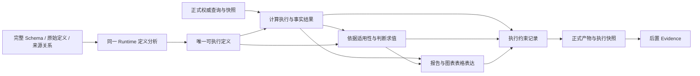

# Runtime 语义到执行闭环设计

状态：设计提案，尚未实现或通过业务验收。基线为 `release/V1.08.02.00-C@e85adcb` 加当前未提交改动。
本提案替代“继续补 Prompt/相近 helper/完整源码封存”的推进路线，保留统一 Runtime、普通 Python、自由叙事、多源查询、Probe、澄清、修复和无模型本地重跑。现有代码和隔离试验不因本文而视为已实现。

## 1. 从目标反推责任，而不是从错误选择补丁

目标是正确、完整、可解释、可重跑的洞察。必须分别回答：实际读了什么、实际算了什么、依据什么作判断、最终表达使用了什么。一个 Agent 负责全部语义，不等于这四个问题已共用一份实际执行定义。

当前缺口及代码证据：

| 缺口 | 当前实现 | 已知后果 | 所需设计责任 |
| --- | --- | --- | --- |
| 计划与实现是两份表达 | `RuntimeCalculationRule` 的 definition/grain/unit/result_fields、`RuntimeDecisionCondition` 的 condition 等是自然语言；`semantic_implementation_bindings` 只解析引用 | 计划正确仍可生成另一种公式；增加计划字段不改变执行 | 计算定义只有一个执行生产者，不再由下游重新翻译算法 |
| 结果没有成为判断的受控输入 | 引用定位到计划对象，缺少对应的运行时计算实例与条件求值记录 | 正确比较函数旁边又取 first/idxmax 或写固定建议 | 计算结果与判断求值分开，实际消费同一结果实例 |
| 表达可另建判断路径 | 完整 Python 自由拼接 Markdown、标题、图表说明和建议 | 同段事实正确、前缀错误；零命中仍有处置建议 | 明确表达中的事实/判断来自哪里，防止展示层重新实现计算与规则 |
| 技术完成被当作总体达标 | 正式结构化执行成功转 COMPLETED；Evidence 解释保存后的产物 | 源码、引用、保存、Evidence 合格被误读为业务正确 | 分别记录执行约束、解释可追溯性和业务验收，不使用一个 pass 混合三者 |

引用：`src/agent/runtime_working_context.py:522,548,701`；`src/agent/runtime_driver_state.py` 正式成功分支；`src/agent/tools.py::_validate_generated_code_contract/_validate_structured_result_contract`。已有来源分离修正保留：Preparation 模型解释不等于原始定义。

明确不采用的解释：所有失败都是缺 Schema、没有 helper、少一次模型观察、或缺一个事后 Review。冻结请求已提供完整 Schema 与人工核对计划，错误仍在初次实现生成内出现。

## 2. 唯一语义所有者与唯一执行定义

Runtime 仍负责分析选择、查询、算法、判断、图表与报告；Preparation 不新增指标或报告规划权。后端提供执行与约束，不另设指标 Agent、Report Agent 或报告审核阶段。

**算法的唯一权威表示是实际可执行定义。** 对后端支持的通用运算，定义为参数化运算图，由确定性代码执行/编译，不再要求模型另写一份等价 Python 公式。复杂自定义运算允许普通 Python 函数，函数源码本身就是定义；后端不能由一段文字推断该函数的全部业务意义。定义的说明由其元数据展示，不能再生成一份独立算法说明并当作执行依据。

语义规划保留分析目标、完整问题、总体、来源依据和未知项。与计算有关的口径在唯一可执行定义中逐步细化，避免同时要求完整自然语言算法计划和另一份完整程序。探索产生新定义时在同一 Runtime 中登记并修订；不强制事先穷举指标、判断或报告章节。

“同一段代码封存”不足以替代上述设计。它只能保证发布后字节未变，不能阻止初次代码中存在两套公式或判断。新的约束要作用于计算、求值与展示的交接，而不只作用于整个文件。

## 3. 数据流与协议对象

以下是逻辑接口，不是已经增加的模型 Schema/API，也不要求每个对象一次模型调用。

### 3.1 可执行定义 SemanticDefinition

复用现有 question_id、fact_id/output_fact_ids 的身份，不另建竞争性的指标目录。每项定义包含：

- 定义身份、版本、所回答的问题、输入身份和直接输出身份；一个结果身份只能有一个生产者。
- 查询范围、实际源字段、实体身份、输入和输出粒度、比较总体。
- 执行实现：通用 operation + 参数，或一份自定义 Python 函数及其输入输出协议；两者是替代路径，不重复描述同一个算法。
- 单位、精度、非可加量的聚合规则、连接基数/守恒要求、空集/零分母/缺失行为。
- 业务含义依据及其来源状态。版本或 source reference 只证明身份，不能证明解释正确。

通用能力包括过滤、分组、求和、去重计数、比例、加权计算、完整极值集合、关系连接等。不得把支持列表作为分析能力上限；不支持的算法使用自定义函数，并记录自动验证边界。不能把无法自动证明误报为算法错误。

### 3.2 运行时事实 FactResult

事实结果绑定本次 execution_id、定义版本、实际参数和 QuerySnapshot，交付标量/记录/表以及实际口径。必须区分：

- 原始总体、展示子集、比较总体、分组结果和选中的全部对象；极值子集不自动代表完整分布。
- 可加金额、单位价格、比率、均值、实体数量与记录数量。
- valid、empty、missing、source_unavailable 等执行状态；零值不是缺失，部分来源为空不是全部无数据。

后端保存版本化结果，消费方读取副本。若展示需要变换，记录为派生变换，不能原地改写同一身份的权威结果。Python DataFrame 的 frozen 外壳不保证内容不可变，不能用它替代保存边界。

### 3.3 判断求值 DecisionEvaluation

判断定义消费 FactResult，不从报告标题、首行或另一套原始 DataFrame 重新计算。定义含比较对象、适用范围、判据来源与条件；求值记录 actual_inputs、依据适用性、true/false/unknown/not_applicable、实际命中对象和不能确认的原因。

纯数学判断由已有确定性运算执行，不需要外部业务阈值。业务评价必须保留真实规则及其适用对象/范围；可计算一个百分比不代表有健康或风险标准。缺规则时保留事实分析与可解释的探索，不默认为健康、安全或无需处理。false 与 unknown 不合并成 otherwise。

条件为真不证明自然语言解释或引用的规则正确。规则本身的解释仍是 Runtime 的语义责任；模型自报 confirmed 或能找到引用不构成认证。自定义条件的自由 Python 同样保留此边界。

### 3.4 展示消费 ReportBinding

报告、图表、表格中的计算值引用 FactResult 的身份与选择路径；正式比较/评价/条件性建议引用 DecisionEvaluation 的本次求值。格式、顺序、叙述方式、图表样式和普通 Python 动态表达仍由 Runtime 自主选择。

展示实现不重写公式、条件或命中集合。需要新的推导时登记新计算/判断定义，再消费新结果，不在标题或建议字符串中悄悄建立新算法。

数学事实表达可由确定性求值结果生成。业务解释与建议必须区分已给规则、分析推导、待确认假设，不能由格式化器默认为“确认事实”。未识别或无法追溯的自由文字不得被标为已验证判断。

**这里存在必须明确保留的验证边界**：自由自然语言可能包含未声明的评价；关联正确、调用正确或加了 judgement_id，均不能机械证明文字与该判断语义一致。不能把所有正文包进一个回调、把错误评价标成 commentary，或用关键词门控声称已解决。这不是可留给字段完善的小细节，而是整份报告业务验收的必要检查项。设计约束能减少重复求值并定位错误，不能替代完整文本验收。

### 3.5 执行快照与 Evidence

持久化唯一可执行定义/程序、定义版本、本次参数、查询快照、事实结果、判断求值与展示引用；重跑恢复定义并重新查询、重新计算、重新求值，不能沿用旧判断状态或草稿 DataFrame。

Evidence 消费实际执行边界与展示引用，确定性解释已发生的计算。对新语法和未登记自由数值仍保留现有高召回扫描与有界消歧，不能因新协议而降低覆盖。Evidence 不修改业务结论，不成为前置报告规划者；不能用 Evidence complete 认证语义。

## 4. 后端能保证什么

| 可实现的检查 | 前提 | 不能扩大成的保证 |
| --- | --- | --- |
| 定义/结果唯一生产者及依赖完整 | 身份与版本协议成立 | 定义的业务含义正确 |
| 标准运算按定义执行，结果复用 | 确定性运算执行器；展示消费结果引用 | 自定义 Python 与文字定义自动等价 |
| 连接基数、实体键唯一性、重复扩增检测 | 显式粒度/连接约束与实际记录 | 一律禁止多对多，或认为一对一必然业务匹配 |
| 金额与已定义核算关系的守恒/残差 | 关系及单位/范围已明确 | 由差额自动断定哪个来源字段错误 |
| 单位与非可加量的受支持运算检查 | 来源单位已确认、运算规则支持 | 任意单位字符串或模型声明都已认证 |
| 完整比较集合与 true/false/unknown 求值 | 全体结果与可执行条件 | 未给业务依据时认证风险、健康、效率 |
| 展示数值和选择路径来自本次执行 | 显式展示引用 | 任意自由正文没有额外断言 |
| 无模型重跑得到新结果与新判断 | 定义/参数/查询绑定完整 | 历史快照本身就是永久正确业务标准 |

这些约束针对真实执行，不是检查源码里是否出现某个函数名。出现 binding/来源引用/条件分支，不作为通过依据。

## 5. 完成状态、失败路径与修复

不在主链路加入事后模型 Review。现有 COMPLETED 可以继续表示本次交付已终止，但不能把它当作整体业务验收证明。内部验收记录分开保存 execution_contract、trace_coverage、business_acceptance；未做业务验收就是未评估，不能默认 pass。这些是工程验证边界，不要求在产品页面暴露内部实现术语。

| 失败 | 处理责任 | 可修订范围 |
| --- | --- | --- |
| 来源访问/查询技术错误 | 同一 Runtime 的查询修复 | 查询实现及受影响结果；不能伪装为空集 |
| 粒度/连接基数/守恒违例 | Runtime 核对实际定义与查询，必要时 Probe | 定义或查询；下游结果与判断失效重算 |
| 数学条件错误或对象集不全 | 唯一判断/计算生产者 | 对应定义，重算其依赖；不只修饰报告文字 |
| 规则适用性未知 | 读来源/Probe；实质影响答案且无法判断时澄清 | 未知定义；保留其他有效分析，不整体退成失败 |
| 部分来源为空 | 保留成功路径并披露覆盖 | 受影响定义及结果状态，不能补零冒充成本/数量 |
| 全部必要范围确为空 | 现有无数据观察、必要纠偏与最终说明路径 | 不能跳过确认，不能只把 no_data_found 当交付 |
| 展示错用结果或文字表达错误 | 同一 Runtime 的展示修复 | 保留正确计算与范围；不用重建公式修复措辞 |
| Evidence 未覆盖 | 后置证据服务补全/记录限制 | 不改算法、数据和正文 |

修复依据最新定义及实际诊断，在一次上下文中处理同根问题。技术 patch 改动若改变执行定义，必须同步产生定义新版本并使下游记录失效；不能保持旧“正确计划”元数据却替换公式。允许显式探索和语义修订，不冻结错误计划。

## 6. 用已知案例检查设计，而不是靠示例选方案

| 已知失败/反例 | 闭环设计必须如何响应 | 验收性质 |
| --- | --- | --- |
| 变化单价 first × 总销量 | 标准成本求值在适用明细粒度运算后聚合；自定义代表单价算法须有适用依据与粒度检查，不因 source reference 而放行 | 算法+业务口径 |
| 生产单位成本 × 销量冒充实际生产成本 | 保留销售数量加权情景，实际生产数量缺失保持未知；销售结转成本独立核算 | 业务含义，不只数值相等 |
| 连接重复扩增 | 执行时检查声明基数与金额/实体守恒，显示违例并修正定义或连接 | 可确定性验证 |
| 全等/并列选 first 或 idxmax | 计算完整集合；判断消费集合；所有相关展示引用同一集合 | 计算+展示一致性 |
| 零非运行设备仍建议处置 | 命中集合为空，对象依赖建议不适用；其他建议仍可基于真实问题提出 | 求值+完整正文 |
| 安装→投产、kW→产能 | 保留原始定义，缺转换/业务依据不升格；不是用数学公式证明业务关系 | 来源与业务语义 |
| 正确事实前加相反前缀 | 已声明展示不重新求值；自由文字的额外断言仍须完整报告验收 | 不以结构通过冒充解决 |
| 空集只返回信号 | 核对确认与最终可读说明/建议，禁止伪造零值或空产物 | 完整交付 |

设备与成本只是固定回归案例，不作为生产规则特判。业务验收仍保留原问题的报告深度、图表表格、多源与探索范围。

## 7. 实现顺序与每步必须完成的交付

不并行扩大模型协议、执行器、Evidence 和持久化，不把模块拆分混入语义改造。

1. **确认单一执行定义接口**：复用现有身份，完成通用运算与自定义 Python 的替代接口、结果/判断/展示消费协议及兼容策略。手工反例先验证它们确实执行同一算法，不只是引用同一个 ID。没有这个证明，不进入模型整批生成。
2. **闭合确定性执行链**：先落实完整极值集合、粒度敏感金额与条件求值及其实际展示消费；覆盖正常、并列、单项、零命中、单位变化、重复连接、部分来源为空和全部为空。两类业务含义缺失反例不能只用数值/接口通过认证。
3. **接入统一 Runtime，移除重复算法表达**：不同时保留强制全文自然语言算法计划与新可执行定义让模型维护两份。保持材料/Probe 职责，按实际依赖提供上下文；新定义不增加一个必经 LLM 阶段。
4. **真实生成与完整串行复跑**：两个固定问题，各三次独立生成作为筛查，任一同根错误停止并定位到定义、执行、求值或正文。通过后再跑 Preparation→Runtime→保存→Evidence/resolver→本地重跑服务，以及受影响的原验收矩阵。
5. **按完整正确交付统计性能**：全部模型调用/token、Probe、修复、执行和 Evidence 均计入。目标是减少同一算法/判断的重复生成与 Evidence 重建，不预设具体提速百分比。保留同期基线，隔离生成耗时不能充当全链路改善。

历史程序继续按现有快照重跑，不自动改公式或回填新的语义认证。新协议只用于新执行；兼容流程仍保留业务验收边界。未通过前不整体切换生产。

## 8. 最小接口与实现选择

下面列出第一步必须实现的接口语义。名称是概念标识，不承诺直接以这些名字新增生产工具。

| 接口 | 输入 | 输出 | 执行约束 |
| --- | --- | --- | --- |
| define | 问题身份、源/结果引用、通用运算参数或自定义函数、口径与依据 | 唯一定义及版本 | 同一版本只有一份可执行实现；不存在另一份要模型重写的公式 |
| execute | 定义版本、本次参数、真实查询结果 | FactResult + 实际约束观测 | 先验证适用粒度/基数，再运算；输入身份和实际总体可追溯 |
| evaluate | 判断定义、FactResult 引用、实际规则依据 | DecisionEvaluation | 用受支持谓词或唯一自定义条件执行，保留未知和全部命中对象 |
| present | 结果/求值引用、格式及自由表达实现 | 报告/图表/表格 + 展示绑定 | 声明的数值与数学关系由实际引用取值；附加文字不自动认证 |
| snapshot/rerun | 定义/代码、参数协议、查询绑定与展示实现 | 新执行的查询/事实/求值/产物 | 使用当前数据重算，不复用旧求值状态 |

### 8.1 支持的运算不是另一份公式说明

例如，一个分类数量定义选择“按分类分组，按实体键去重计数”。该定义的输出直接供极值求值、图表、表格和正文数值使用。后续 Python 不再自行生成第二份 groupby/count 或按排序首项代替全部极值对象。

在成本明细中，行内量乘以适用行内数量再聚合，和“选一行的单价乘全部数量”是两个不同定义。标准执行器应分别保留选择范围、数量范围和聚合粒度。只有当适用组内价格/成员条件满足已声明前提时，才能作对应的跨粒度折叠。不能因为单位算出来都是元而忽略数量含义与价格变化。

量价是否适用仍须业务语义依据。执行器可以证明乘法和范围，不能由乘法成功证明生产数量等于销量；业务含义缺失时保留明确情景或未知，而不是改变结果身份冒充实际成本。

### 8.2 普通 Python 的兼容路径

复杂统计、预测、异常检测或任意合法算法可以声明自定义函数。后续执行直接调用该函数，而不是按其摘要再生成函数。执行器核对实际输入输出、声明的范围与受支持的不变量；不对任意 Python 声称已证明公式正确。

现有完整程序保留。迁移不是把任意旧源码自动推断为已验证定义；新定义编译/调用后仍构成完整可重跑 Python，复用现有 worker、保存与图表契约。未覆盖的已有语法维持原执行和 Evidence 解析路径，不能为了迁移删除分析。

### 8.3 自由正文的真实责任边界

不新增一个“自由备注”来豁免业务断言。所有报告文字仍由 Runtime 负责，测试和完整报告评审覆盖正文、标题、图表说明与建议；动态段落可消费同一组事实/求值视图。编排容器不能另建权威数值或判断实例。

关联协议对可识别的显示值/关系证明来源，确定性表达对受支持数学命题证明求值；自由业务解释保留语义验收责任。若报告写出“所有类型相同但差异明显”，即使其结构绑定有效，整份报告依然失败，不将句子标为 commentary 后计为通过。该缺陷若持续发生，定位为表达实现或规则含义错误，修复该生产者；不能继续扩大定义元数据掩盖失败。

**设计选择是增强可执行的一致性，并保留自由叙事的业务验收，不承诺自动证明所有自然语言。** 这是能力与验证边界的明确选择，不是一个隐藏在接口中的认证漏洞。若要求任意自由业务文字也由代码完整保证真假，当前方案不满足；不能靠一句“统一消费结果”承诺满足。

### 8.4 生命周期与旧计划的处理

计算定义身份复用现有结果身份，规则和结果在同一执行工作区内关联；快照扩展以 `AnalysisExecutionSnapshot` 及现有 QuerySnapshot 为锚点，不新增并行的全局指标注册系统。

旧自然语言计划可用于问题目标/未知项/来源上下文，不能与新定义同时充当算法权威。兼容模式继续执行旧程序并明确有限证明；新模式从单一定义构造执行与显示。语义修订与技术修复都在同一 Runtime 内完成，版本失效沿依赖传播，不新建模型评审节点。

## 9. 当前审查结论与未解决项

已明确职责、数据流、逻辑输入输出、确定性检查、失败/修复路径、兼容与实施顺序。该设计比新增计划字段或封存源码更直接作用于语义到执行的交接。

接口选择和兼容原则见第 8 节。**尚未验证的工程问题**：通用运算引用能否在现有 worker/程序血缘中成为唯一执行生产者；结果与求值视图能否在普通 Python 中可靠复用；现有 Evidence 能否准确识别该调用/显示路径。**持续保留的业务验收问题**：自定义公式、规则含义及自由正文是否正确。这些不能由接口存在而默认解决。

当前不是最终可上线方案，也不宣称所有语义已可机械证明。设计审查之后的首个工程增量见第 10 节；尚未注册新的 agent 工具，没有模型调用、数据库变更或部署。后续工程推进以本责任边界和验收顺序为准，既有源码封存原型保持隔离。

## 10. 首个工程增量与验证（2026-10-05）

新增 `src/analysis_runtime/semantic_execution.py`，作为主动导入才使用的执行模块，未接入默认 agent 入口。实现范围是去重计数、按经过唯一键检查的明细逐行相乘再求和、完整极值集合求值，以及消费已保存求值的事实表达。同一执行中相同定义再次调用返回已有事实，修改定义不能覆盖原生产者；结果视图与输入隔离，跨执行引用被拒绝。金额支持 Decimal，并显式区分缺失传播与排除缺失的部分结果。

`expressions.py` 抽出已有极值表达的内部格式器，使新模块使用保存的求值直接表达，不再重算极值；原公开函数仍保留原使用方式。这是可执行一致性的实现，不是又增加一份模型维护的算法说明。

验证记录：

| 验证 | 结果 | 能证明的范围 |
| --- | --- | --- |
| 三个相关测试文件 | 100 项通过 | 计算、完整并列集合、未知/单项状态、引用隔离、定义不可覆盖、缺失和数值精度等机制 |
| 17 次手工 worker 用例 | 独立事实检查通过；12 次正常报告交付、2 次故意错误正文交付、3 次空数据/重复键信号 | 新模块可被完整普通 Python 程序消费；不是模型生成验收 |
| 14 份已交付报告与原手工基线比较 | 文本全部一致 | 此次替换保留这些程序的已有报告内容，不证明报告已达到业务深度要求 |
| 两份真实文件 worker 执行 | 实际查询快照存在，结果契约及独立数值检查通过 | 未替换文件读取或查询 helper，可在现有 worker 内执行 |

记录目录为 `.codex-regression/semantic-execution-20261005/`：`hand-r1/summary.json`、`hand-r1/baseline-report-comparison.json`、`real-files-r2/summary.json`。真实文件首轮检查脚本错误地从 `exec_result` 读取快照，检查项失败；实际快照在 worker 顶层。修正后复跑通过，`real-files-r1/` 原记录保留。手工用例共执行 37 个原生事实、32 个极值求值（包含负向控制），这些不是独立模型样本。

**尚未闭合**：自定义 Python 定义、一般业务条件、受治理连接算子、字段变换血缘、单位及数量含义验证、可持久化执行快照、Evidence/resolver 识别及默认 Runtime 接入。当前 query key 和 unit 是声明；真实文件检查仅核对 key 存在，不能证明变换来源和单位含义。成本输入连接的唯一性由手工程序已有逻辑检查，不能算作新模块实现了连接治理。

两个故意错误的自由正文仍通过结构校验，整份报告业务验收失败。这一结果符合第 8.3 节的证明边界，也说明整体准确性尚未收敛。没有新增真实模型筛查，无法报告模型准确率或全链路性能改善。

下一工程顺序：先将实际 QuerySnapshot 与事实输入/变换关联，并为 Evidence 增加该路径的识别，验证当前数据重新查询后的新事实和求值；随后补齐自定义算法兼容与 Runtime 接入，移除重复算法权威。接入之后再按第 7 节开展真实模型和完整链路复跑，不凭当前局部通过切换生产。

## 11. 查询绑定与 Evidence 执行目录增量（2026-10-05）

### 11.1 本轮闭合的机制

`provenance.py` 实现 worker 内主动启用的采集上下文。必须在查询前创建 `SemanticExecution`；已有分析未启用时不计算数据指纹。查询 helper 在成功查询时记录实际返回的 DataFrame 身份、含原始数值类型的数据指纹及当时的 QuerySnapshot。`add_query_source` 只接受本次 worker 返回且尚未修改的对象；DataFrame attrs、复制品、上次执行的对象不能替代真实查询回执。普通 `add_source` 继续兼容，但血缘状态为声明。

保存结果现在携带 `semantic_execution_traces`，包括执行身份、源回执、已执行定义、事实值和判断；`AnalysisExecutionSnapshot` 读取该记录，新的结果摘要覆盖它，避免不同定义共享旧缓存。worker 初始化会清除上次采集状态，参数重跑必须产生新的查询、事实与判断。

Evidence 的 `LineageIndexer` 新增 `semantic_execution_nodes` 目录。它核对实际成功查询快照、快照摘要、输入行数及真实返回字段，区分 `query_bound` 与 `unresolved`。通用计算在库内部执行，目录直接读取保存的定义和事实，不要求模型再次解释算法。`query_bound` 只证明这个执行来源链，不认证业务规则、单位含义或任意 Python。

`table(fact_ref)` 返回的实际视图被表格 helper 消费时，helper 保存事实引用和表格内容摘要；Evidence 将对应数值列关联到事实节点。视图被修改/复制后不建立这一直接绑定；helper 后表格内容被修改则记录未验证。这个机制依据实际消费，不通过数字相等或字段名称猜测来源。图表和自由正文的同等消费绑定尚未实现。

### 11.2 验证与边界

- 计算、表达、执行目录和现有 Evidence 测试：409 项通过；文件过滤、图表契约与执行历史兼容检查另有 264 项和 4 个子测试通过。不是模型准确率统计。
- `.codex-regression/semantic-execution-20261005/query-bound-r1/`：真实设备文件的 4 个事实和 4 个表格数值列获得来源绑定；成本原查询获得绑定，连接后的量价情景明确未验证；独立数值检查通过。
- `query-bound-feb-r1/`：实际月份参数改为二月，新查询和事实重新生成，金额与独立 CSV/Decimal 基线一致；没有修改输入文件或历史结果。
- 反例覆盖修改查询对象、伪造 attrs、复制视图、旧执行引用、查询失败/消失/约束变化、只声明变换来源、保存后修改表格，以及新数据下极值判断变化。

**没有完成完整 Evidence 验收**：当前执行目录和表格事实关联供后续编译消费，现有 metric definition 编译与 resolver 尚未用这一目录完成端到端接入，不能标记 Evidence complete。真实文件程序仍为手工能力验证，无模型生成、服务部署或历史数据库写入。自定义算法、连接/变换血缘、图表与正文绑定、规则含义、数量与单位含义仍待完成。

性能方面仅确认未启用的旧程序不进行新增数据指纹计算；启用后指纹和保存事实存在开销，尚未测量整链路净收益，不宣称提速。

下一步优先补齐连接/变换的执行来源链，让成本量价情景具有真实可追溯输入；随后把已保存事实及产物绑定接入既有 metric definition 编译/resolver，并补齐图表绑定。完整执行链可用后，再迁移 Runtime 的定义权威与自定义 Python 路径，开展真实生成验收。自由业务正文继续承担整份报告的业务验收责任，不因来源绑定有效而豁免错误结论。

## 12. 连接、转换与现有 Evidence 编译/解析接入（2026-10-05）

### 12.1 已落实的接口边界

新增两个主动使用的源定义：`OneToOneJoin` 和 `DecimalColumns`。前者执行前检查两侧完整连接键非空、实际唯一，显式选择 inner/left/outer，记录匹配、左侧未匹配、右侧未匹配及输出数量；同一输出身份不能被另一份连接定义覆盖。后者在执行链内部完成十进制转换，保留缺失，拒绝非法数值。连接以 object 类型保留数值，避免未匹配记录使大整数隐式转为浮点数。

输出字段保留每一侧的源身份及原字段名；重名列按显式后缀区分。Evidence 递归验证实际查询回执，沿已执行连接/转换追到原查询字段。任一上游查询失败、快照变化或输入没有受验证来源，后续事实不获得来源认证。这证明执行来源、数学粒度和本次实际连接行为，不证明两侧业务实体关系、数量口径或单位含义。

已绑定表格的事实现在成为现有 `PostAnalysisEvidenceCompiler` 的确定性计算候选，通过原有计划编译产生 metric definition 和 table ref。它读取执行定义，不要求模型重新解释算法；记录完整字段来源、转换定义、匹配观测、分组及缺失策略。相同事实的多处展示复用一个计算边界，不因显示值碰巧相同而合并不同事实。

现有 resolver 可消费这些定义和表格 ref，返回实际选中值、计算公式及来源。采用已有质量说明展示证明边界和未匹配范围，没有新增报告生成节点、模型评审节点或另一套 resolver。默认 Runtime 尚未改用这些定义；任意旧 Python 路径保持兼容。

### 12.2 实际验证与未通过项

| 范围 | 结果 | 限制 |
| --- | --- | --- |
| 10 个相关测试文件 | 690 项、4 个子测试通过 | 包含连接/转换、计算/表达、Evidence 编译、现有 public resolver（数据库读取使用夹具）、查询/保存兼容；不是模型或部署验收 |
| 原 17 个手工 worker 用例 | 全部执行完成；独立事实检查通过；14 份正文与原基线一致 | 12 份正常交付、2 份故意错误正文、3 个空数据/重复键信号；错误业务结论仍失败，信号不算正确最终交付 |
| 三月真实设备及成本文件 | 4 个设备表格指标、1 个成本情景表格编译为 native Evidence 定义；resolver 展示使用相同实际值与公式 | 完整报告和其他图表/表格仍保留原血缘路径，未解决的报告项继续使整份 Evidence 为 partial |
| 二月实际参数重跑 | 查询范围与执行身份改变，重新连接及计算；独立金额检查通过 | worker 参数重跑，不是部署后服务 API 验收 |

三月销售数量加权情景仍为 **11,932,609.9225 元**，逐条适用单位成本乘同条销量后求和；这不是已确认的实际生产成本。native Evidence 同时保留 `单位生产成本_元` 来自成本查询、`销量_件` 来自销售查询，以及本次完整业务键连接观测。实际生产数量缺失这一业务限制未因技术链通过而消失。

记录目录：`native-join-r1/`、`native-join-resolver-r1/`、`native-join-feb-r2/`、`native-join-hand-r2/`，均位于 `.codex-regression/semantic-execution-20261005/`。公开 resolver 测试的首次夹具把引用放错元数据层级，修正后通过；隔离手工适配脚本抽取时损坏了多行字符串，首轮未进入成本执行，修正后复跑；17 个用例全部完成后，汇总 JSON 对 Decimal 序列化失败，逐用例原记录完整保留，修复序列化并从原记录重建汇总，没有重新执行或修改观察值。这些是验证工具错误，不隐去失败记录，也不计为业务修复。

**关闭的缺口**：受支持连接/转换下的查询→字段→计算事实→表格→Evidence 定义→resolver 数据链。**仍未关闭**：图表和自由正文直接消费绑定、任意自定义函数接口、默认 Runtime 的单一定义权威接入，以及完整真实模型报告准确性/深度/性能验收。两个故意错误正文反例仍通过结构检查，整体业务验收失败；本轮无模型调用、数据库写入、部署或提交。

下一阶段转向 Runtime 接入：复用已经验证的执行接口，处理自定义算法兼容，替换重复的自然语言算法权威与二次 Python 翻译，同时保留完整分析能力。随后用固定问题的独立真实生成和完整串行复跑检验设计是否收敛；同根错误复现即定位到最早错误边界，不继续增加只约束案例的提示词。尚未测量端到端性能净收益，不宣称提速。

## 13. Runtime 接口与自定义算法接入（2026-10-06）

正式 worker 直接提供上述执行类和 `PythonCalculation`，既有 implement/repair 契约提供真实签名与消费边界。语义计划的 `definition` 保留业务含义和用户给定公式要求，不再要求先写一份自然语言算法、随后把它翻译成另一份 Python 算法。唯一可执行算法在本次实际程序内；历史计划结构和任意 Python 能力保持兼容。这是接入与责任变更，还没有机械保证每份模型程序实际采用新接口。

`PythonCalculation` 保存实际函数源码、代码摘要、显式参数和输入身份，调用原函数一次；输入及参数使用副本，后续复用保存结果。同一结果身份不能被另一函数、算法或参数覆盖。支持数值标量或包含主数值列的 DataFrame；不适合这个返回形态的算法仍可使用普通 Python。任意闭包、全局变量或外部访问不因此获得字段血缘证明。自定义计算明确标记 `execution_only`，不能冒充原生的 `query_bound` 或确定性公式认证。

正式 worker 测试验证了真实 CSV 查询、无需 import 的执行类调用、自定义源码捕获、同一执行内缓存及参数变化后的新执行。相关回归共 **930 项测试、4 个子测试通过**。首次测试发现 marshal 的字符串驻留编码在执行后变化，使同一函数缓存误判为算法变化；现改用递归代码语义摘要，实际执行前后及参数重跑用例通过。另有两次测试进程在未显式设置本地环境时无输出等待，停止已核实属于本次的进程后，以 `PROFILE=local`、`LOG_ENABLE_FILE=false` 和 UTF-8 显式环境运行成功；尚未确认等待的根因，不归因于业务算法。

下一项观察为一次真实模型 implementation 筛查，使用固定完整 Schema、已落地工作上下文、现有 `submit_analysis_program` 和真实文件。保留原始响应、程序、执行结果及完整报告，不自动修复失败样本。该筛查不包含重新生成 Preparation/语义计划或完整服务 Evidence，不能当作端到端验收。

### 13.1 筛查失败揭示的协议缺口

`.codex-regression/semantic-execution-20261006/model-screen-r1/` 保存一次真实模型调用的请求、响应、原程序和 worker 错误。源契约检查通过，实际文件查询成功返回 10 行，但报告构造在第 393 行引用未定义的 `status_extrema_result`，worker 失败，没有最终报告或结果契约通过记录。不能把源码里的报告模板当成已生成报告，也没有补变量后悄悄重新计为通过。

模型没有调用 `SemanticExecution` 或其他新定义类，仍生成独立 pandas 算法。源码把缺失/非法功率 `fillna(0)`，正文模板静态宣称类型功率存在差异、运行中状态占主导及安装变化与产能扩张相关；末尾虽然说明安装日期不等于投产时间，前文的推断仍无依据。这里的“缺失填零”是实现缺陷，不声称原始文件实际含缺失值。一次样本不能估计错误率，但足以否定“公开接口及重写契约就已完成 Runtime 迁移”。

**最早尚未封闭的边界是计划结果身份→实际执行回执→产物消费。** 当前 `semantic_implementation_bindings` 给出业务结果身份和意图，但提交/保存并未要求每个实际交付指标绑定唯一执行事实；新 API 因而可被完全绕过。自由正文也没有强制从已求值事实或判断记录取得变化的断言。末尾说明文字不能修复前文的不成立判断。

接下来沿同一设计补齐迁移模式的交付协议：对计划中的计算结果保存实际事实绑定与覆盖状态，未绑定明确为未迁移；兼容算法通过真实函数执行回执接入，而不是按自然语言重新造算法。迁移程序须在正式交付前满足结果身份唯一、输入身份及参数可追溯、产物实际消费覆盖；新增必要指标仍可加入同一计划，不能靠减少指标通过。正文的变化结论需携带已求值事实/判断及业务依据，不能靠匹配敏感词认证。自由叙述保留，但业务结论继续接受完整报告验收。先落实该协议及反例，再开展新的真实生成；本次不继续提示词试错。

性能记录：单次模型调用连同 worker 总耗时 59.453 秒，真实查询记录为 6.164 秒；输入 33,642 token、输出 3,669 token。前者包含生成、执行和本地处理，不当作纯生成耗时；未采集完整服务阶段时延。客户端沿用既有传输重试配置，记录的一次调用指一次 `invoke`，未独立观测 HTTP 请求次数。没有数据库写入、服务部署、历史结果重编译或提交。

## 14. 宿主要求的计算执行覆盖（2026-10-06）

宿主从当前 `runtime_work_packet.semantic_plan` 提取每个问题的 `calculation_rules.output_fact_ids`，去重后传入 worker。这些要求不来自生成程序的 save 参数。worker 清空上一轮状态，再恢复当前要求；没有当前计划的旧程序继续按 legacy 路径执行，不声称已迁移。

`execution.bind_result(question_id, result_id, fact)` 只接受本工作区实际执行的事实引用；允许多个展示共享一个生产者，拒绝同一身份在同一工作区更换生产者。保存时从本轮实际工作区读取绑定：任何必需结果缺失、或在多个工作区分别绑定，都阻止成功保存，并列出未覆盖身份；数值相等不使多个生产者合并。结果保存 `semantic_execution_coverage` 与 trace 中的绑定。业务结果身份与函数/原生定义身份可以不同，不为匹配名字另算一次。

表格 helper 同时记录实际事实视图的消费摘要，保存时核对最终表格内容与本轮 helper 消费记录。仅修改表格值后伪造同样的元数据不会成为已消费；同一事实的多份正确展示可以复用记录。当前每个结果分别记录 `executed`/`missing`/`ambiguous`，以及 `table_consumed`/`not_verified`。全局 presentation 状态仍为 `not_verified`，业务状态仍为 `not_evaluated`，**执行覆盖不是完整交付覆盖**。尚未把图表和正文纳入消费闭环，也不按计算身份或值相等认证业务算法含义。

为避免要求绑定后缩减分析能力，自定义函数新增显式 `value_kind="object"`，保留日期区间、分类和复杂对象输出，按原函数实际执行一次，结果和视图保留深副本。`value_kind` 描述主结果字段的语义类型，不描述 DataFrame 形状；含有主数值字段和分组/辅助列的结果仍声明 `value_field` 与 `value_kind="numeric"`，供比较及极值消费。只有没有主数值字段的对象输出使用 `value_field=None, value_kind="object"`，不进入数值极值求值。默认 numeric 类型继续检查有限数值。参数摘要保留实际 Python 类型，避免 Decimal 与同文本字符串被当作同一参数。自定义函数仍只取得 execution_only，不因此获得输入字段或公式认证。

验证结果：

- 最终相关回归 **940 项、4 个子测试通过**，覆盖宿主计划到 worker、未绑定失败、同值多生产者失败、旧执行回执拒绝、原生和自定义绑定、日期/复杂对象副本隔离、类型不同的参数变化、表格实际消费及伪造摘要反例、旧计划/保存和现有 Evidence 兼容。
- `delivery-real-files-r1/` 使用真实 10 行设备文件和既有完整手工分析，两次 worker 分别保留未绑定失败和绑定成功；四个分布计算及表格全部有对应回执，正文逐字相同。只适配绑定，不减少指标或改写报告；这是手工能力验证，不能计为模型准确率或全链路业务验收。
- 新测试首次遗漏必需的声明 query_key，随后表格夹具遗漏 title；修正测试夹具后通过。首次批量进程无输出等待，停止已核实属于本次的两个 Python 进程；增加 faulthandler 的独立测试启动后正常完成。此前实际模型失败记录保持原样，本轮无新增模型调用。

关闭的是宿主计划计算身份到实际执行生产者的强制覆盖，以及已支持表格的消费观测。下一步沿同一协议补图表和正文的实际消费；需区分“展示读取事实”与“业务判断有依据”，不能把动态数值旁的任意静态评价视为已认证。尚未修改历史数据库、部署、提交或声明性能达标。

## 15. 图表与正文的实际消费回执（2026-10-06）

`SemanticExecution.chart(fact, helper=..., **options)` 把本次保存事实的视图直接交给已有 chart helper，没有另写图表计算算法。支持 result、document、multi_metric 和 suite；仍使用既有排序、显示精度、TopN 和尾项处理。只有事实主列实际参与数值编码才记录这份事实的图表消费，辅助列不因此自动认证。回执包含实际 helper、参数及规范化图表摘要。

保存阶段已有 chart normalizer 会改变规范化图表。最初直接比较两个阶段的摘要使正常消费也失去覆盖，测试发现后改为沿真实宿主规范化转换记录回执：只有输入图表与本轮已记录消费一致，宿主才登记规范化输出摘要。内容已修改并伪造新摘要的图表不能沿此路径取得新回执。图表回执证明实际 helper 消费，不认证标题里的业务判断或复合指标含义。

正文采用实际对象装配，不搜索相等数值或相同文字：`render_value` 读取已保存事实并只标记实际值范围；前后任意文字不成为事实证明。`render_extrema` 读取已保存数学判断并生成片段，仍处理空、单项、全体相等及并列对象。`compose_report(parts)` 按原顺序连接片段与自由文字，记录精确 Unicode 字符范围；支持嵌套章节装配。最终对象必须直接进入保存，装配后改写、把片段先变成普通字符串、未使用的片段或旧 worker 对象，都不获得直接消费证明。现有保存整理若改变装配正文，也保守记为未验证，而不是猜测新位置。

片段值显示格式也随回执保存；数学排名片段携带对应 decision 身份。自由解释、建议、因果或风险推断保持完整能力，但其 `business_status` 仍为 `not_evaluated`。给数值前后添加“风险很高”不会使这段评价进入已绑定范围。各计划结果记录 table/chart/report 的实际消费渠道，整体 presentation 状态仍保持 `not_verified`，因为局部渠道覆盖不能证明整份报告已覆盖。

验证：

- **950 项测试、4 个子测试通过**，新增正常 chart helper 与保存规范化、篡改图表、仅展示辅助列、正文实际范围、同文普通字符串、未使用片段、跨 worker 对象、并列极值与嵌套章节反例。首次带延迟 faulthandler 的测试进程在导入阶段发生 Windows access violation，未形成测试结论；独立启动后的测试正常运行，未确认该启动失败根因。
- `presentation-real-files-r1/` 保留基线和采用直接消费后的两次真实文件 worker 记录。四个设备分布事实均在表格、图表和正文数学片段中实际消费；完整正文逐字相同，全部图表/表格数量保留，两次 worker 和结果结构检查通过。功率、日期及其他既有正文保留，仍按原路径分析，不因这些部分尚未迁移而删除。
- 本轮没有新增模型调用，旧真实模型失败仍保留；没有写历史数据库、部署或提交。这是手工真实文件能力验证，不是模型准确率、完整 Evidence 或业务验收。

新增图表/正文消费回执尚未接入既有 Evidence 编译及 resolver；已有原生表格路径继续工作。下一步沿这些实际记录接入既有 Evidence，使点击值、展示转换与计算边界一致，再开展正式 Runtime 的完整真实生成和参数/数据复跑。不能把局部消费或执行覆盖等同于错误自由正文已经被拦截，也尚未测量整链路性能净收益。

## 16. 图表和正文事实值接入既有 Evidence（2026-10-06）

执行快照保留实际 `semantic_execution_coverage`，有计划结果时把它纳入 result_hash；消费位置或报告摘要变化不会沿用旧编译缓存。没有这些结果的旧路径保持原结果 hash 材料。编译器沿已有 LineageIndexer、计算候选及定义编译路径关联图表/正文事实，未新增报告 Agent、模型评审节点或另一套 resolver。

图表关联同时核验最终图表摘要和本次生产事实。既有 chart normalizer 可能把原指标字段改名为展示字段，现沿真实数值编码位置保存 `encoded_field`，不按标签、词义或相同值猜测列映射。原字段仍在事实定义及来源中，点击字段使用实际展示列。回执携带 helper 参数与规范化步骤，源单位和业务含义仍为声明/未评价。

图表运算另设证明边界：保留已有 bar/line 重复绘图键拒绝规则；显式 series 使绘图粒度唯一时可直接关联事实行。饼图尾项合并、箱线统计及其他尚未证明与事实行一致的展示变换只记录 execution_only，不把其合计/统计值解释成某一事实行的原公式。图表仍照常生成，这些变换的确定性 Evidence 尚待支持。

正文不是整段绑定。共用的实际格式化过程记录字段跨度：单值显示或极值段落中的 `value` 可沿本次事实关联原公式，保留显示格式和 decision 身份；极值段落中的 valid_count、标签数字及其他文字不顺便取得该公式。位置必须精确匹配数值产物，且整份报告摘要一致。嵌套章节与前后空白整理会同步移动实际跨度，没有通过相等数值猜位置。格式化后的正文值与图表/表格可以复用相同计算定义，单元位置仍各有引用。

验证与失败记录：

- 最终 **961 项测试、4 个子测试通过**。新增图表与精确正文值无模型公式恢复的编译、相同数字但不同指标边界、变更后失效、coverage hash、Unicode/嵌套跨度、通用列名/中文列名的规范化映射，以及公开 chart/report resolver（数据库读取用夹具，无写入）。公开解析保留图表值 2 与正文显示值 2.00，两者使用相同 `去重计数(id)` 公式，业务语义仍未评价。
- `presentation-evidence-real-files-r1/` 保留首次真实 worker、完整正文、lineage 和编译结果；图表原列与规范化展示列不一致导致四个新图表未关联，验证脚本在取预期引用时 StopIteration。修复通用编码映射后，r2 通过；补充展示运算证明边界后，以最终实现复跑的 r3 也通过。测试中原先以为重复分类会被展示聚合，实际已有 helper 明确拒绝，已按现有契约校正反例，保留拒绝规则。
- r3 的真实 10 行设备文件中，四个分布计算各有一个表格、图表和正文直接引用，共 **12 个直接引用**；三种公开 resolver 均可用，完整正文逐字不变。完整编译记录包含原有路径的其他引用，并未删除这些内容来提高覆盖；整份 Evidence 仍为 **partial**。

手工真实文件验证不等于正式模型或服务全链路验收。本轮无新增模型调用、历史数据库写入、部署或提交，旧真实模型失败仍保留。**尚未关闭**：比较项数量等派生判断指标的确定性定义、自定义算法全字段/公式证明、展示聚合变换，以及完整自由业务结论的依据和准确性；不因局部回执而认证任意业务解释。下一步以现有统一协议检验正式模型完整生成和参数/数据变化下的交付，同时逐项补支持的确定性算子，不能靠减少报告范围把 partial 改为 complete。

## 17. 正式生成筛查失败与复跑约束修正（2026-10-06）

`model-screen-r2/` 使用当前完整 Runtime 实现契约、原会话的实际 Schema/工作包及既有历史，通过部署模型工厂调用 MiniMax-M2.7-highspeed 一次；transport retries=0。这是冻结实现上下文的模型筛查，不是重新执行 Preparation、规划和服务 API 的全链路验收。筛查脚本改为只提取独占行标签，避免旧脚本把提示中的内联标签举例误取成实际上下文；因此不能将 r1/r2 差异归因于生产设计变化。首次本地启动在请求写出前停滞，核验所属进程后终止；第二次记录 importtime 并成功完成调用。启动时间不计入模型生成时间，也不解释成计算性能。

本次输入 22926、输出 3419 tokens，生成 50.391 秒，调用与 worker 共 59.781 秒。源码静态契约通过，真实文件查询成功，模型生成了完整旧式计算和展示，但没有创建 SemanticExecution 或绑定计划中的任何计算身份。11 项 required results 全部 missing，worker 在 save_analysis_result 拒绝交付；没有保存成功报告、结果契约通过或 Evidence 通过的结论。原响应、生成源码、执行源码与错误均保留，未对失败样本自动修补或补调用。

源码审视另见：极值辅助函数已采用，但完整正文仍从 iloc[0] 断言单个位置/制造商/安装年份最多，绕开并列集合；“状态反映健康度”“额定功率反映功率负荷”及位置与生产核心地位、集中采购优势等表述缺少对应业务依据。这些是未保存源码的风险观察，不伪称已对最终报告完成业务验收。

该失败说明运行时拒绝未绑定交付的机制生效，但模型实际采用率在这一样本为零。不能由手工可表达性推导正式生成已收敛，更不能撤掉门槛把旧式结果算通过。当前生成边界仍是整份自由 Python 加长文本契约；计算身份与判断依据没有成为提交协议中的必需输入。下一设计步骤须先明确结果定义、算法及依据如何在生成入口结构化交付并由宿主统一执行/装配，保留任意 Python 算法和完整分析范围；禁止从元数据、函数调用存在或相等数字反推真实生产者。应先验证绕过反例，再做一次完整模型筛查，不继续等价提示重试。

同时修复一个已经证实的链路缺陷：原参数复跑快照未保存强制计算身份，LocalAnalysisRuntime 与任务返回序列化也丢弃本次 traces/coverage。现在手动复跑和定时任务快照仅保存 question_id/result_id 要求，不保存旧 token、fact 或正文跨度；本次 worker 重新生成事实与回执。快照要求优先于调用方传入的空列表，防止复跑悄悄降低交付约束。结果序列化保留新回执；无新契约的旧快照和结果保持原序列化形式。这不会自动认证历史旧报告，也没有给本地复跑增加模型或 Evidence 编译阶段。

验证覆盖真实 worker 参数变化（2→3，12→18、新 token、新正文跨度）、未绑定拒绝、旧快照兼容、深拷贝，以及 SQLite 夹具中的手动复跑与定时任务快照入口。本轮没有历史数据库写入、部署或提交。整体业务准确性及整链路性能仍未达标，不能把这些测试解释为模型验收通过。

最终相关回归 **1061 项测试、10 个子测试通过（28.53 秒）**，diff 检查通过。首次广泛回归中新增任务测试错误地解包夹具对象，修正测试后重新执行同一测试集合全部通过；没有修改生产逻辑来迎合该测试错误。

## 18. 对下一步方向的修正（2026-10-06）

用户明确要求不做补丁、不做无意义语义校验重试。进一步职责审计发现第 17 节“让计算身份与判断依据成为提交协议必需输入”的建议不足以解决首次生成的错误，不能继续沿此建议扩大必填字段和拒绝机制。现有回执及执行约束仅保留其原始证明边界，不作为准确性收敛成果。

下一步以 [初次生成职责决定](runtime-generation-responsibility-decision-20261006.md) 为准：处理自然语言计划、实际执行及展示中重复产生判断的责任；先移除重复算法/条件生成的工作要求，再以唯一执行定义承接计算和判断。自由正文的语义正确性仍不能由身份或来源关联保证。该决定是架构审计与实施边界，不是新机制已经验证或生产已重构。

## 19. 第一处职责调整：新规划不再预写判断程序

新公开规划输入使用 RuntimeDecisionIntent，只保存判断需求及其依据和输入；旧 RuntimeDecisionCondition/RuntimeSemanticPlanInput 保留历史读取。生成工具与按当前问题投影的 Schema 已切换，新意图进入既有 semantic_plan，无新状态或数据库迁移。规划不再要求 condition/when_true/otherwise 或逐字段算法；原始业务公式、规则、粒度及计算要求保留，正式程序负责算法和可执行判断。

新/旧输入的实际工具处理、工作状态交接、原始约束保存与参数复跑相关回归共 **398 项测试、6 个子测试通过**；diff 检查通过。本步无新增模型调用、历史回写、部署或提交，未新增语义校验或重试。完整准确性及性能未验收，正式执行和自由展示之间的重复判断路径仍待处理。细节见职责决定的后续落地记录。
