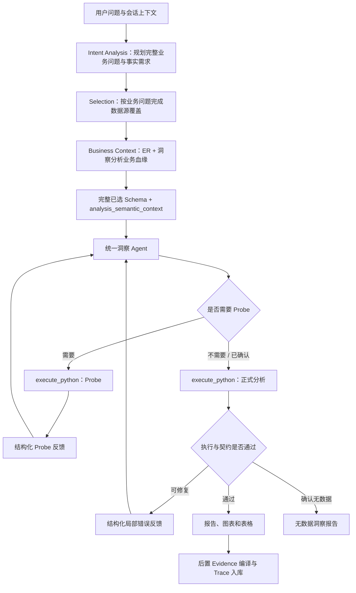

# 统一洞察分析架构 V2

## 1. 文档定位

本文档定义 DataInsight 下一轮改造的目标架构。实现基线固定为：

- 分支：`release/V1.08.00.00-C-refactor`
- 提交：`3f52c94`

这次改造不是把 Workflow Stage 方案重新移植到原版，也不是继续叠加
`codex/unified-analysis-runtime` 中的实验代码。目标是在保留原版统一洞察 Agent
能力的基础上，引入已经验证有价值的 Preparation 和 Runtime 能力。

## 2. 改造目标

### 2.1 保留原版优势

原版以下能力必须保持：

1. 一个 Agent 完整拥有查询、指标、图表、表格和报告的洞察语义。
2. Probe、正式分析和代码修复处于同一个 ReAct 对话上下文。
3. 模型根据用户问题、完整数据源 Schema 和会话上下文自由规划报告。
4. 报告由 Python 代码动态构建，允许条件判断和不同数据结果下的不同表达。
5. 无数据必须经过真实业务查询与必要探测确认，并生成面向用户的说明和建议。
6. 本地重新执行、追问、刷新和原轮次重跑能力保持可用。

### 2.2 解决原版问题

本轮改造必须解决：

1. 数据源范围过大时，正式 Agent 同时承担选源，导致上下文膨胀和选源漂移。
2. 多数据源之间的业务关系没有在正式分析前得到充分整理。
3. 模型在一份 Python 代码中同时手写 Metric、Evidence 和 TraceRef，职责过重。
4. 不同计算逻辑的指标可能误用同一个 Evidence，或引用不相关 Evidence。
5. Evidence 的计算步骤、单位和业务说明不够准确、稳定、易读。
6. Prompt 中业务语义、代码规范、数据源协议和工具说明混杂，难以按需加载。
7. 修复反馈可能脱离原始洞察目标，逐轮删除内容，最终得到契约通过但表达贫乏的报告。

## 3. 核心设计原则

### 3.1 洞察语义只有一个最终所有者

正式洞察 Agent 是以下语义的唯一最终所有者：

- 查询口径与过滤条件
- 数据源使用方式和关联策略
- 指标及计算逻辑
- 图表和表格设计
- 报告结构、判断、总结和建议
- Probe 结果的业务解释
- 修复后的完整分析目标

Preparation 不能规划或冻结这些内容。

### 3.2 Preparation 交付完整洞察语义空间，不交付执行计划

Preparation 只负责：

1. 将用户目标分解为共同构成完整回答的业务问题，并描述每个问题所需的业务事实概念。
2. 围绕全部业务问题选择完整数据源集合，逐问题说明事实覆盖，保证用户明确提出的对象和口径不漏选。
3. 补充选中数据源之间可确认的 ER 关系。
4. 建立问题到业务事实、Schema 字段和关系路径的洞察分析业务血缘。
5. 将完整已选 Schema 与轻量业务语义上下文作为一个内聚输入交给正式分析。

Preparation 不输出：

- report plan
- query plan
- metric plan
- 图表或表格计划
- 主辅数据源角色
- 事实粒度要求
- 强制分析维度
- 推断出来的硬过滤条件

业务问题覆盖和业务血缘是正式分析的语义入口，但不是查询、指标或报告模板。Preparation 失败或信息不完整不能终止分析。它只能：

- 使用已确认的部分信息继续；
- 将未确认关系标记为 unresolved；
- 在无法完成选源时退回原版授权数据源上下文。

### 3.3 完整 Schema 与业务语义上下文共同构成唯一交付物

Preparation 的正式输出不是历史版本中包含角色、粒度、Probe、指标和报告规划的庞大业务契约，而是：

```text
selected_datasource_ids
selected_datasource_snapshot
  └─ 每个数据源的完整 Schema
       └─ relationship metadata
analysis_semantic_context
  ├─ business_goal / business_questions
  ├─ question_coverage
  └─ insight_lineage
```

其中：

- `business_questions` 表达完整业务意图；每项所需事实只在 Intent 中定义一次稳定 `fact_id`、业务名称和语义定义，明确业务对象、事件、度量与必要时间含义；
- `question_coverage` 按每个 canonical `fact_id` 分别记录 `direct/partial/unresolved`、支撑来源和原因；问题级状态、问题来源和最终选源集合全部由事实覆盖在本地确定性推导，LLM 不重复填写这些派生字段；
- `insight_lineage` 继续用同一 `fact_id` 将业务问题、真实字段和关系路径组织为连贯语义；每项事实必须落在已绑定或未解决集合中；
- 不包含 SQL、计算公式、Metric、图表、表格、报告章节或预设结论。

正式分析不再重新选源，也不能静默缩减用户明确提出的业务问题；它在该完整语义空间内自主决定查询、计算和表达。

关系元数据至少表达：

- 本数据源字段
- 目标数据源及字段
- 业务关系含义
- 关系状态：verified / unresolved
- 验证依据：schema / probe
- 可确认时的基数与覆盖情况

样本行和 Probe 明细不进入后续上下文。

### 3.4 Probe 是统一洞察 Agent 的能力

原版 Probe/No Data 主链保持不变：

1. 正式 Agent 可以直接生成完整分析代码。
2. 代码必须检查关键业务查询是否有数据。
3. 查询无数据或口径不明确时，Agent 可生成 `execution_intent = "probe"` 的轻量探测代码。
4. Probe 返回结构化反馈，在同一个 ReAct 上下文中继续生成正式分析代码。
5. Probe 只确认候选值、格式、时间覆盖、存在性或关系，不生成正式 Metric、Evidence 和报告。
6. 确认查询口径后，正式分析重新查询和计算，不能消费 Probe 样本作为正式结果。
7. 多次 Probe 仍确认无数据时，生成完整无数据报告，而不是流程失败报告。

Preparation 在验证 ER 关系时可以复用同一组底层 Probe API，但不能把这条技术
验证链变成正式分析的前置硬门槛。

### 3.5 Evidence 在正式分析成功后编译

目标关系为：

```text
成功的正式分析代码与 QuerySnapshot
  -> LineageIndex (真实计算与产物位置)
       -> calculation signature (一个计算逻辑边界)
            -> EvidenceDefinition (唯一 Evidence)
                 -> TraceRef (报告、图表或表格中的使用位置)
```

规则：

1. 正式 Agent 不手写 Metric、Evidence 或 TraceRef。
2. 同一个计算签名可以被报告、图表和表格共同引用。
3. 不同计算签名不能共享 Evidence。
4. 派生比率、差额、增长率和组合值必须形成独立计算签名和 Evidence。
5. grouped 计算按一个计算列形成 Evidence，各成员通过 selector 定位；不能按单元格生成 Evidence。
6. TraceRef 由 LineageIndex 与产物位置编译，不由模型手写 ID。
7. 不扫描 Markdown 数字来反推 Metric 或 Evidence。
8. Evidence 错误不能推翻正式分析成功，也不能触发业务代码重写。
9. 详细设计以 `post-analysis-evidence-architecture.md` 为准。

### 3.6 报告仍由统一洞察 Agent 自由表达

报告不是本地固定模板，也不是指标说明清单。

正式 Agent 应根据问题和真实计算结果动态决定：

- 核心结论
- 关键数值发现
- 趋势、结构、排名、对比和异常
- 业务含义
- 风险与限制
- 基于事实的建议

后置 Evidence 编译链只负责：

- 生成可点击位置
- 保证单位与展示值一致
- 保存 Evidence 与 Trace 元数据

Markdown 由统一洞察 Agent 的正式 Python 代码直接生成和保存，后置编译链不得改写。

不得使用固定章节数量、最低段落数量或文本数值扫描作为报告质量的主要保证。

## 4. 目标流程



Preparation 可以使用本地 Schema 关系或受限 Probe 验证 ER，但它不改变
`E -> G -> H -> E` 这条正式分析口径探测闭环。

## 5. 上下文组织

正式 Agent 的上下文按以下层次组织：

1. **角色与输出目标**
   - 数据洞察分析专家
   - 统一拥有完整洞察语义
2. **业务规则**
   - 用户问题
   - 会话补充规则
   - 时间和用户显式约束
3. **数据源上下文**
   - Preparation 选中的完整 Schema
   - 内聚后的 ER 关系
   - 完整业务问题、逐问题选源覆盖和洞察分析业务血缘
4. **数据访问协议**
   - 仅加载当前数据源类型需要的查询能力模块
5. **分析代码协议**
   - Probe/Analysis 生命周期
   - Python 代码结构
   - No Data 处理
6. **分析产物 API**
   - 正式 Agent 只负责报告、图表和表格产物
   - Evidence 由成功执行后的独立编译链生成，不进入正式 Agent 主 Prompt
7. **对话历史和短期记忆**
   - 按当前问题相关性压缩
8. **执行反馈**
   - 最近失败代码
   - 类型化诊断
   - 保持不变的原始洞察目标

完整选中 Schema、当前问题、核心 API 契约属于不可裁剪信息。优化上下文应通过
去重、模块按需加载和历史压缩完成，不能删字段或限制选源数量来迎合 Prompt 容量。

## 6. 失败与澄清边界

### 6.1 不属于失败的情况

以下情况不能生成失败报告：

- Intent 输出不完整
- Selection 置信度不高
- ER 关系无法确认
- Preparation LLM 超时或格式错误
- Probe 首次没有命中数据

### 6.2 同轮次澄清

只有同时满足以下条件才向用户澄清：

1. 歧义会实质影响答案；
2. Schema 与 Probe 都无法可靠消除；
3. 不存在合理、可披露的默认业务解释。

澄清支持快捷选项和自由文本，并在同一个 turn 内挂起与恢复。恢复后继续原 Agent
分析目标，不创建一条新的用户问题。

## 7. 明确禁止迁移的历史方案

以下方案不得从实验分支整体迁移：

- 将 Query、Metric、Insight Program、Code 拆成多个洞察语义所有者
- Preparation 失败后路由 `fail_report`
- 用 Preparation 字段范围裁剪正式 Schema
- 用 report plan 或 report metric 冻结最终报告语义
- 本地固定报告模板替代模型叙事
- 解析 Markdown 数字来生成或校验 Evidence
- 为单个会话添加字段字面量、单位字面量或业务状态补丁
- 为通过校验而禁止合法图表、指标或叙事能力
- 将 Probe 样本当作正式分析结果
- 将代码修复拆出原 ReAct 上下文

## 8. 验收标准

### 8.1 稳定性

- Preparation 常规一次通过，异常时可降级继续。
- Runtime 首次生成尽量通过；发生错误时，同类错误最多一次修复。
- 不在阶段间往复，不出现前置阶段失败报告。
- 取消、刷新、追问和本地重执行行为正确。

### 8.2 准确性与证据链

- 指标算法与业务名称一致。
- 不同计算边界不共享 Evidence。
- 每个可点击数值关联正确 Evidence 和当前值。
- 图表按指标列、表格按业务数值列、报告按代码表达式锚点绑定。
- 单位只影响展示，不改变底层计算值。
- Evidence 说明使用业务语言，同时保留可审计查询与转换谱系。

### 8.3 报告质量

- 不是指标罗列或 API 说明。
- 同时包含数据事实、判断、业务解释和必要建议。
- 数值支撑关键判断。
- 图表、表格和报告围绕同一个洞察主线，相互补充。
- 至少达到原版同问题报告的信息密度和自然表达能力。

### 8.4 性能

- Preparation 增加的耗时必须由正式 Agent 上下文缩减和重试减少抵消。
- 常规单数据源问题不应无条件增加多个 LLM 调用。
- 不以裁剪核心 Schema 或缩小合法分析能力换取性能。

