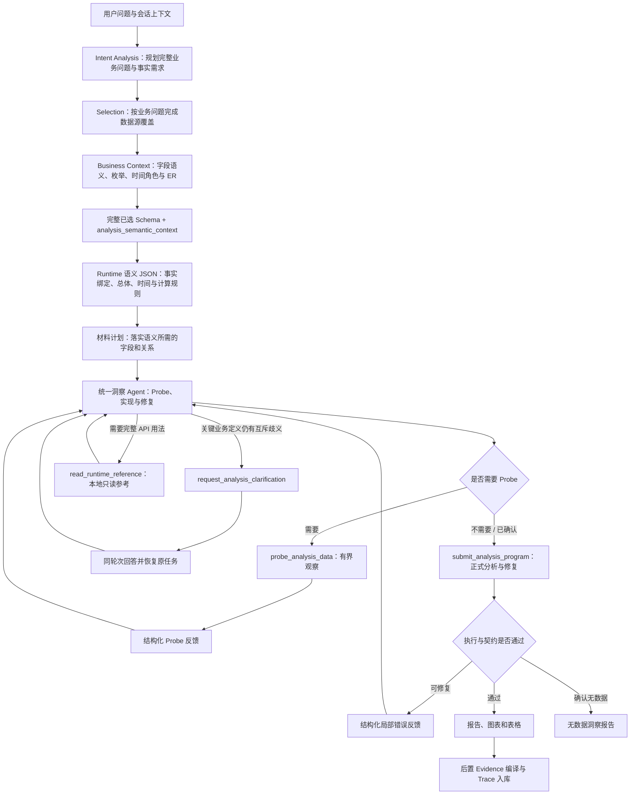

# 统一洞察分析架构 V2

## 1. 文档定位

2026-10-05 设计审查补充：[Runtime 语义到执行闭环设计](runtime-semantic-execution-contract-design.md)
明确现有自然语言计划、实际算法、判断求值和报告消费之间的未闭合责任边界。
该文是待落实的协议设计，保留本文统一 Runtime 与自由分析原则，不表示新接口已实现或通过业务验收。
近期局部试验及其停止决定见 [Runtime 收敛决定](runtime-convergence-decision-20261005.md)。

本文档定义 DataInsight 下一轮改造的目标架构。实现基线固定为：

- 分支：`release/V1.08.00.00-C-refactor`
- 提交：`3f52c94`

这次改造不是把 Workflow Stage 方案重新移植到原版，也不是继续叠加
`codex/unified-analysis-runtime` 中的实验代码。目标是在保留原版统一洞察 Agent
能力的基础上，引入已经验证有价值的 Preparation 和 Runtime 能力。

2026-09-03 实施说明：以上提交是最初重建起点；本轮 Runtime 改造的直接对照基线为
`be9d3fd7bbaf81ce354459425a85d41078799e40`。本轮工程决策、落实清单与真实验收边界见
[方案因果复核第 8-9 节](runtime-design-causality-review-20260902.md)，上下文与工具接口详见
[Runtime 上下文设计](runtime-context-capability-design.md)。总体语义职责保持本文原则，不新增指标规划或审核阶段。

同日补充的[分析程序连续构建设计](runtime-program-construction-design.md)目前是待实施提案：
在同一 Runtime 中支持信息积累和一份 Python 程序的增量构建，不拆分指标/报告语义，
不表示当前系统已经有草稿编辑和局部验证工具。

## 2. 改造目标

### 2.1 保留原版优势

原版以下能力必须保持：

1. 一个 Agent 完整拥有查询、指标、图表、表格和报告的洞察语义。
2. Probe、正式分析和代码修复处于同一个 ReAct 对话上下文。
3. 模型根据用户问题、完整数据源 Schema 和会话上下文自由规划报告。
4. 报告由 Python 代码动态构建，允许条件判断和不同数据结果下的不同表达。
5. 无数据必须经过真实业务查询与必要探测确认，并生成面向用户的说明和建议。
6. 本地重新执行、追问、刷新和原轮次重跑能力保持可用。

### 2.2 解决原版问题

本轮改造必须解决：

1. 数据源范围过大时，正式 Agent 同时承担选源，导致上下文膨胀和选源漂移。
2. 多数据源之间的业务关系没有在正式分析前得到充分整理。
3. 模型在一份 Python 代码中同时手写 Metric、Evidence 和 TraceRef，职责过重。
4. 不同计算逻辑的指标可能误用同一个 Evidence，或引用不相关 Evidence。
5. Evidence 的计算步骤、单位和业务说明不够准确、稳定、易读。
6. Prompt 中业务语义、代码规范、数据源协议和工具说明混杂，难以按需加载。
7. 修复反馈可能脱离原始洞察目标，逐轮删除内容，最终得到契约通过但表达贫乏的报告。

## 3. 核心设计原则

### 3.1 洞察语义只有一个最终所有者

正式洞察 Agent 是以下语义的唯一最终所有者：

- 查询口径与过滤条件
- 数据源使用方式和关联策略
- 指标及计算逻辑
- 图表和表格设计
- 报告结构、判断、总结和建议
- Probe 结果的业务解释
- 修复后的完整分析目标

Preparation 不能规划或冻结这些内容。

### 3.2 Preparation 交付完整洞察语义空间，不交付执行计划

Preparation 只负责：

1. 将用户目标分解为共同构成完整回答的业务问题，并描述每个问题所需的业务事实概念。
2. 围绕全部业务问题选择完整数据源集合，逐问题说明事实覆盖，保证用户明确提出的对象和口径不漏选。
3. 补充选中数据源之间可确认的 ER 关系。
4. 建立问题到业务事实、Schema 字段和关系路径的洞察分析业务血缘。
5. 将完整已选 Schema 与轻量业务语义上下文作为一个内聚输入交给正式分析。

Preparation 不输出：

- report plan
- query plan
- metric plan
- 图表或表格计划
- 主辅数据源角色
- 事实粒度要求
- 强制分析维度
- 推断出来的硬过滤条件

业务问题覆盖和补全后的 Schema 是正式分析的语义入口。问题级事实血缘、统计口径和计算规则由 Runtime 语义规划生成。Preparation 失败或信息不完整不能终止分析。它只能：

- 使用已确认的部分信息继续；
- 将未确认关系标记为 unresolved；
- 在无法完成选源时退回原版授权数据源上下文。

### 3.3 完整 Schema 与业务语义上下文共同构成唯一交付物

Preparation 的正式输出不是历史版本中包含角色、粒度、Probe、指标和报告规划的庞大业务契约，而是：

```text
selected_datasource_ids
selected_datasource_snapshot
  └─ 每个数据源的完整 Schema
       ├─ relationships：来源关系与已核实的连接证据
       └─ properties[*].semantic_enrichment：字段含义、枚举及时间语义
analysis_semantic_context
  ├─ business_goal / business_questions
  ├─ question_fact_coverage
  └─ semantic_references / runtime_probe_agenda
```

其中：

- `business_questions` 表达完整业务意图；每项所需事实只在 Intent 中定义一次稳定 `fact_id`、业务名称和语义定义，明确业务对象、事件、度量与必要时间含义；
- `question_fact_coverage` 按每个 canonical `fact_id` 保留 Selection 的覆盖判断和候选来源；这些是 Runtime 核对事实的选源依据，不是已经确定的字段或计算绑定；
- Business Context 的模型输出只有字段语义、来源关系、未知关系与 Schema Probe 请求。字段补全和关系写入数据源 Schema，交给 Runtime 时不再单独传递 `insight_lineage`；
- 不包含 SQL、计算公式、Metric、图表、表格、报告章节或预设结论。

正式分析不再重新选源，也不能静默缩减用户明确提出的业务问题；它在该完整语义空间内自主决定查询、计算和表达。

Runtime 内的 `plan_runtime_semantics` 用工具 JSON Schema 保存一份可修订的语义定义：

```text
runtime_semantic_plan
  ├─ analysis_goal
  └─ questions[*]
       ├─ question_id / analysis_focus
       ├─ population / time_basis / grouping_and_comparison
       ├─ facts[*]：fact_id、meaning、direct/derived/unresolved
       │    ├─ source_bindings：datasource_id、fields、role
       │    ├─ derived_from_fact_ids
       │    └─ unresolved_reason
       ├─ relationship_ids
       ├─ calculation_rules：purpose、definition、basis、input_grain、output_grain、unit
       │    ├─ input_fact_ids / output_fact_ids / group_by_fact_ids / entity_key_fact_ids
       │    └─ result_fields：表/记录的计算字段、公式与单位，单值不重复定义
       ├─ decision_conditions：purpose、basis、criterion、source_references、condition、when_true、otherwise、supporting_fact_ids
       └─ unknowns：schema/probe/business_clarification、issue、consequence
```

它承接原问题级血缘的事实来源、派生关系与未知项，并由 Runtime 补充分析口径。
字段引用按后端完整 Schema 核对，不能按 Prompt 的聚焦投影判断字段是否存在。
语义确认工作直接接收全部已选来源的完整 Schema，承接 Preparation 补充的字段含义、
枚举、时间语义与关系，不依赖模型再次主动读取才能获得这些分析依据。该工作不装载
代码实现协议；来源索引只保留身份，避免重复字段定义。实现、Probe 与修复仍使用各自
工作视图，完整 Schema 留在后端，不把语义确认的全量输入常驻到所有状态。
事实编号属于 Runtime 的分析分解，不要求与选源阶段编号相同；业务问题覆盖仍须保留。
判断条件描述运行时分支而非预写结论，无法确定业务判据时保留事实性表达。
材料计划消费这份对象，只组织具体读取和探测依赖。Probe 新事实或用户澄清改变口径时，
修订同一个语义对象并重建材料计划；后续仍生成一份可重跑的完整 Python 程序。

材料计划、实现与修复的 Schema 工作视图在当前材料依赖之外，自动并入有效语义计划的来源字段绑定。
已声明的计算输入、维度、单位与名称依赖不再要求模型从材料目录重新发现或再次主动读取。
该合并仅作用于已选来源、只增加已声明字段，不推断未知绑定或修改语义计划，不改变查询
授权和选源范围。定向 Probe 保持自身的资料范围，不自动扩成全部正式分析依赖。新的依赖
仍可通过原 Schema 读取工具发现；已选完整 Schema 继续保留在后端。

计算与判断引用本问题内的事实，避免公式文字、来源绑定和分组说明各自独立解释。
`output_fact_ids` 在计算规则内直接声明结果；算法、粒度和单位由该规则承载，不要求在
`facts` 中重复创建结果对象。输入引用可指向来源事实或计算结果，分组与判断同样可复用
结果标识。每个结果只能有一个计算生产者，不能覆盖来源或未确认事实；未知输入引用
仍作为协议错误反馈，不本地推断公式或补造字段。后续计算与判断复用这些结果，而不是从
指标名称重新推断结果含义。语义规划既设计如何求值，也设计这些结果可支持的事实解释、
比较和建议依据；代码负责真实求值和条件表达。未确认的业务评价保留事实替代表达与待补依据，
不是可直接执行的判据。此承接不冻结报告章节，不预写真实结论，不增加后置 Review。
来源绑定的 `role` 是用途描述，不是执行权限或工作状态枚举；真实来源 ID 和字段归属仍需核对。
`result_fields` 区分同一结果表内的数量、占比、总量与均值；判断引用结果及其计算字段。
`criterion` 记录实际解释依据与出处，`condition` 记录执行时求值的条件，条件可计算不等于
业务判据已有依据。这些字段不增加本地语义拒绝检查，也不要求提前穷举全部指标。
工作包保存完整语义对象；对模型的工作视图省略可重建的默认值，但不能要求模型像
Pydantic 一样重建具有语义的缺省值。明确提交的空依赖、空实体键、空字段表、空判据引用、
空关系和空未知项均保留，不能把“明确为空”压成“没有说明”。`group_by_fact_ids`
（包括分组未确定的 `null`、总体分组的 `[]`）、非空字段定义、
判据和未知项均保留；遇到未知扩展内容或不能无损解析的对象，保持原样，不猜测压缩。
语义工具的参数错误反馈只返回结构化错误位置、类型与原因，候选对象由原始工具调用保留，
不在反馈中再次复制整份对象。参数失败不会推进工作状态，也不会丢弃上一份有效语义计划。
这属于协议反馈整理，不代表对语义正确性的本地判定或业务校验。

结果唯一生产者及输入引用检查返回冲突标识与准确声明/引用路径，不只给出抽象错误原因。
结构反馈不代替模型选择正确算法，也不自动合并重复计算或把未知引用改成相近字段名。
分类与筛选在已有计算规则定义内表达成员条件，不新增专用指标协议；业务分类依据尚未确定
时继续保留原始事实分析及未确定项。分析方向名称本身不代表成员算法已确认。

Python 调用发生 TypeError 时，对同一语句列表中随后连续出现的同一调用对象，反馈可提供
有界的完整语句修复候选。候选不表示已经确认这些调用错误，正确调用仍应保留；不同调用、
重新绑定或控制块会终止候选范围。候选不自动改写源码、不跨工作状态、不引入业务校验；
原版本摘要、准确源码区间及合成后完整程序校验仍适用。完整程序替换的原有能力不变。

正式 Python 可以使用小型确定性计算原语：`select_extreme_rows` 返回全部并列极值行，
`compare_numeric_values` 区分小于、相等、大于和缺失，`calculate_ratio` 求比例并在
零分母或缺失时返回 `None`。这些函数不生成业务结论、不设业务阈值、不调整统计总体，
也不新增工作阶段或语义拒绝门控。返回值由正式代码复用于报告和结构化产物；业务解释
仍依赖真实判据。Evidence 将比例调用按真实分子、分母及缩放编译公式，极值调用按
排名操作保留原查询依赖，不把函数名当作证据，也不绕过计算边界验证。
`evaluate_numeric_comparison` 将互斥关系谓词、差额和相对变化集中在同一次求值结果中；
`summarize_extrema` 将完整极值行、可比较范围和并列状态集中返回。二者不设业务阈值，
不据此推断健康、风险或集中度，且不新增执行状态。Evidence 对比较结果的差额和相对变化
分别解析公式和计算边界，不能因为同一函数返回多个字段就合并指标。
`source_references` 定位判据实际来源与原文，与定位计算输入的 `supporting_fact_ids` 分开。
这些引用是可审查的模型声明，不是语义已正确的认证；字段定义或枚举存在不等于业务评价
规则存在。数学关系无需外部规则。此增量不增加引文词面校验、语义重试门控或执行后 Review。
派生事实可以引用已有事实，也可以直接绑定来源字段；不要求为字段变换虚构中间事实。
不使用报告词面与 AST 启发式匹配来校验业务语义：极值、区间方向、时间窗口措辞、
成对指标口径均不作为静态拒绝或重试依据。业务判断由语义规划和实际程序逻辑承接；
程序语法、API 参数及字段归属等确定性检查保留。移除检查不代表语义准确性已经达标。
判断的 `basis` 表示解释依据：`mathematical` 只承载数学关系直接支持的描述，
`schema` / `user` / `conversation_rule` 承载实际提供的业务判据；数值条件可计算
不意味着相应风险、健康或效率评价成立。缺少判据时保留事实描述和待补依据。
计算输入可用只说明可以求值，判断条件必须说明求值后的什么结果支持相应解释；
条件不成立的表达与输入缺失的处理分开考虑，不用“有数据”代替判断依据。
`group_by_fact_ids=[]` 表示总体单值，`null` 表示分组未确定；实体去重键与展示属性分别承载，
展示属性不会自动扩大计算粒度。后端只检查引用存在、字段归属等结构完整性，不以静态语义
校验证明算法正确。模型侧工具 Schema 按当前问题编号和数量约束问题列表，分析方向仍在
每个问题内自由展开。材料计划负责实现依赖，不重新决定已确认的算法；报告结构和表达不被锁定。

关系元数据至少表达：

- 本数据源字段
- 目标数据源及字段
- 业务关系含义
- 关系状态：verified / unresolved
- 验证依据：schema / probe
- 可确认时的基数与覆盖情况

样本行和 Probe 明细不进入后续上下文。

连续失败修正只投影当前失败候选与最新错误；更旧的失败候选和反馈保留在审计记录中，
不再逐次累加到工作视图。最近有效计划与尚未完成的调用不因失败候选归档而被丢弃。

### 3.4 Probe 是统一洞察 Agent 的能力

原版 Probe/No Data 主链保持不变：

1. Runtime 先通过 `plan_runtime_semantics` 提交 JSON 语义定义，再通过 `plan_runtime_materials` 组织资料；已有依据充分时直接进入正式代码实现。
2. 代码必须检查关键业务查询是否有数据。
3. 查询无数据或口径不明确时，Agent 可生成 `execution_intent = "probe"` 的轻量探测代码。
4. Probe 返回结构化反馈，在同一个 ReAct 上下文中继续生成正式分析代码。
5. Probe 只确认候选值、格式、时间覆盖、存在性或关系，不生成正式 Metric、Evidence 和报告。
6. 确认查询口径后，正式分析重新查询和计算，不能消费 Probe 样本作为正式结果。
7. 多次 Probe 仍确认无数据时，生成完整无数据报告，而不是流程失败报告。

正式提交中的 `execution_intent` 与工具不匹配属于代码修复，不作为需要 Probe 的证据。
此类反馈保留正式实现的查询与结果协议；需要新的技术观察时由显式 Probe 请求进入探测。

Runtime Probe 可以核验当前回答所需的枚举、字段格式、时间覆盖、查询路径和无数据口径；它不得重做 Business Context 已确认的跨源关系，也不能把 Probe 样本直接作为正式结论。

Preparation 在验证 ER 关系时可以复用同一组底层 Probe API，但不能把这条技术
验证链变成正式分析的前置硬门槛。

#### 局部修复的基线与记忆

执行记录的源码归属只由真实创建该执行的调用确定。补丁被拒绝且
`new_execution_created=false` 时，返回的执行 ID 仍指向未改变的原基线，
不能用拒绝的调用覆盖其归属，也不能将完整基线从模型工作视图中归档。
原有行级修复授权按基线 ID、源码哈希和原授权范围继续保留；拒绝补丁不扩展授权。
工作视图可将与保留源码精确匹配的错误上下文和授权范围源码副本替换为行号引用，
但完整基线、错误事实、源码哈希及授权坐标必须保留，不匹配的片段不得裁剪。

### 3.5 同轮次澄清属于统一 Runtime 的终止型能力

系统不在正式 Runtime 前增加独立语义规划阶段。统一 Runtime 在同一个 ReAct 上下文中
读取用户问题、业务规则、Preparation 结果和完整 Schema，形成结构化语义计划后决定分析、执行 Probe，
或请求用户澄清。

成功的语义规划在工作视图中转换为动作与结果摘要，完整语义计划由
`runtime_semantic_plan` 单一承载。不得把已完成调用的参数裁剪为工具不接受的结构，
也不得丢失动作完成事实。尚未完成或失败的调用保留原始参数和反馈；审计记录不变。

枚举、格式、时间覆盖、查询路径和有无数据等技术事实由 Probe 确认。只有一个关键业务定义
存在互斥解释、选择会实质改变答案、并且 Schema、业务规则和 Probe 都不能唯一确定时，
Runtime 才调用 `request_analysis_clarification`。该工具终止当前 Agent 图，任务进入
`waiting_clarification`；用户回答后原任务、原轮次恢复，Preparation 不重复执行。

澄清回答作为用户事实注入 Runtime，不形成计算边界、指标清单或报告计划。查询、计算、扩展
洞察、图表表格和报告表达始终由统一 Runtime 完整拥有。详细设计见
`runtime-clarification-design.md`。

用户已确认事实直接回到统一 Runtime ReAct，由同一个洞察语义所有者落实为查询、计算和报告。
系统不再增加澄清答案编译器、执行前语义审核器或基于字段字面量的 Probe 硬门槛。静态契约只
处理语法、安全、字段归属、显式查询范围和产物结构等能够确定性证明的边界。

### 3.6 Evidence 在正式分析成功后编译

目标关系为：

```text
成功的正式分析代码与 QuerySnapshot
  -> LineageIndex (真实计算与产物位置)
       -> calculation signature (一个计算逻辑边界)
            -> EvidenceDefinition (唯一 Evidence)
                 -> TraceRef (报告、图表或表格中的使用位置)
```

规则：

1. 正式 Agent 不手写 Metric、Evidence 或 TraceRef。
2. 同一个计算签名可以被报告、图表和表格共同引用。
3. 不同计算签名不能共享 Evidence。
4. 派生比率、差额、增长率和组合值必须形成独立计算签名和 Evidence。
5. QuerySnapshot 必须区分两层范围：`analysis_scope` 只记录可复用的用户时间范围和目标筛选；`query_scope` 只记录某一物理查询自己的事实、来源、聚合和粒度。后续物理查询可继承前者，绝不能继承首条查询的指标、粒度或事实边界。
6. 未显式声明本地范围的辅助物理查询保留为 `implicit` scope：后置 Evidence 可以从真实 SQL / loader 和计算图继续解析其血缘，但不得把它伪装成首条查询的计算口径。
7. grouped 计算按一个计算列形成 Evidence，各成员通过 selector 定位；不能按单元格生成 Evidence。若图表用类别字段承载多个不同指标，且各点真实计算边界不同，则按点生成独立 Evidence，并由 `point_selector` 定位。
8. TraceRef 由 LineageIndex 与产物位置编译，不由模型手写 ID。
9. Markdown 数字扫描只用于完整定位候选；计算边界仍由 AST、真实查询快照和必要时的 LLM 语义解析共同确定，不能只凭文本数字反推 Metric 或 Evidence。
10. Evidence 错误不能推翻正式分析成功，也不能触发业务代码重写。
11. 派生查询可以通过 `scope_source_query_key + scope_binding` 继承已成功父查询的分析范围：
    父结果字段、子查询目标字段和实际参数必须完整可验证；它不能伪造不适用的时间字段，
    也不能绕过聚合粒度契约。该关系同时写入 QuerySnapshot，供后置 Evidence 还原范围。
12. 日期型参数与带时区午夜时间戳在同一自然日边界下视为等价表达，避免展示格式差异
    触发错误的时间范围修复；非午夜时间仍必须精确匹配。
11. 详细设计以 `post-analysis-evidence-architecture.md` 为准。

### 3.7 报告仍由统一洞察 Agent 自由表达

报告不是本地固定模板，也不是指标说明清单。

正式 Agent 应根据问题和真实计算结果动态决定：

- 核心结论
- 关键数值发现
- 趋势、结构、排名、对比和异常
- 业务含义
- 风险与限制
- 基于事实的建议

后置 Evidence 编译链只负责：

- 生成可点击位置
- 保证单位与展示值一致
- 保存 Evidence 与 Trace 元数据

Markdown 由统一洞察 Agent 的正式 Python 代码直接生成和保存，后置编译链不得改写。

不得使用固定章节数量、最低段落数量或文本数值扫描作为报告质量的主要保证。

## 4. 目标流程



Preparation 可以使用本地 Schema 关系或受限 Probe 验证 ER，但它不改变
`E -> G -> H -> E` 这条正式分析口径探测闭环。

Probe 与正式提交共用原执行底座，参考查阅不执行 Python、不查询业务数据。全部必需协议首次交付，
参考只用于可选的完整用法，不是前置门槛。交互澄清与最终输出按 InvocationPolicy 生效；外部工作流
可选 standard/text/json，禁用同轮次澄清和后置 Evidence。图中标准报告路径不覆盖这些调用策略。

## 5. 上下文组织

正式 Agent 的上下文按以下层次组织：

1. **角色与输出目标**
   - 数据洞察分析专家
   - 统一拥有完整洞察语义
2. **业务规则**
   - 用户问题
   - 会话补充规则
   - 时间和用户显式约束
3. **Preparation 交接与用户澄清事实**
   - Preparation 交接完整业务问题、选源结果、Schema、关系和未解决项
   - 用户澄清后只追加用户直接回答，不生成新的指标边界或报告规划
   - 相同澄清回答只注入一次，Probe 反馈继续留在同一 ReAct 历史
4. **数据源上下文**
   - Preparation 选中的完整 Schema
   - 内聚后的 ER 关系
   - 完整业务问题、逐问题选源覆盖和洞察分析业务血缘
5. **数据访问协议**
   - 仅加载当前数据源类型需要的查询能力模块
6. **分析代码协议**
   - Probe/Analysis 生命周期
   - Python 代码结构
   - No Data 处理
7. **分析产物 API**
   - 正式 Agent 只负责报告、图表和表格产物
   - Evidence 由成功执行后的独立编译链生成，不进入正式 Agent 主 Prompt
8. **对话历史和短期记忆**
   - 按当前问题相关性压缩
9. **执行反馈**
   - 最近失败代码
   - 类型化诊断
   - 保持不变的原始洞察目标

完整选中 Schema、当前问题、核心 API 契约属于不可裁剪信息。优化上下文应通过
去重、模块按需加载和历史压缩完成，不能删字段或限制选源数量来迎合 Prompt 容量。

## 6. 失败与澄清边界

### 6.1 不属于失败的情况

以下情况不能生成失败报告：

- Intent 输出不完整
- Selection 置信度不高
- ER 关系无法确认
- Preparation LLM 超时或格式错误
- Probe 首次没有命中数据

### 6.2 同轮次澄清

只有同时满足以下条件才向用户澄清：

1. 歧义会实质影响答案；
2. Schema 与 Probe 都无法可靠消除；
3. 不存在合理、可披露的默认业务解释。

澄清支持快捷选项和自由文本，并在同一个 turn 内挂起与恢复。恢复后继续原 Agent
分析目标，不创建一条新的用户问题。

## 7. 明确禁止迁移的历史方案

以下方案不得从实验分支整体迁移：

- 将 Query、Metric、Insight Program、Code 拆成多个洞察语义所有者
- Preparation 失败后路由 `fail_report`
- 用 Preparation 字段范围裁剪正式 Schema
- 用 report plan 或 report metric 冻结最终报告语义
- 本地固定报告模板替代模型叙事
- 仅凭 Markdown 数字推断计算边界，或将候选扫描用作正式分析的语义阻断；后置候选定位按第 3.6 节处理
- 为单个会话添加字段字面量、单位字面量或业务状态补丁
- 为通过校验而禁止合法图表、指标或叙事能力
- 将 Probe 样本当作正式分析结果
- 将代码修复拆出原 ReAct 上下文

## 8. 验收标准

### 8.1 稳定性

- Preparation 常规一次通过，异常时可降级继续。
- Runtime 首次生成尽量通过；发生错误时，同类错误最多一次修复。
- 不在阶段间往复，不出现前置阶段失败报告。
- 取消、刷新、追问和本地重执行行为正确。

### 8.2 准确性与证据链

- 指标算法与业务名称一致。
- 不同计算边界不共享 Evidence。
- 每个可点击数值关联正确 Evidence 和当前值。
- 图表按指标列、表格按业务数值列、报告按代码表达式锚点绑定。
- 单位只影响展示，不改变底层计算值。
- Evidence 说明使用业务语言，同时保留可审计查询与转换谱系。

### 8.3 报告质量

- 不是指标罗列或 API 说明。
- 同时包含数据事实、判断、业务解释和必要建议。
- 数值支撑关键判断。
- 图表、表格和报告围绕同一个洞察主线，相互补充。
- 至少达到原版同问题报告的信息密度和自然表达能力。

### 8.4 性能

- Preparation 增加的耗时必须由正式 Agent 上下文缩减和重试减少抵消。
- 常规单数据源问题不应无条件增加多个 LLM 调用。
- 不以裁剪核心 Schema 或缩小合法分析能力换取性能。


## 9. Runtime 内生执行证据（2026-10-08）

Evidence 是正式分析产物链的读取视图。语义规划关联问题和预期结果；查询回执、实际计算定义和结果快照记录执行；展示消费与报告引用记录结果的使用位置。三者属于同一条链，但规划意图不能代替执行，执行可追溯不能代替公式或业务语义正确。

原生 `ExecutablePythonProgram` 端口启用 Runtime 执行证据。宿主在查询、计算、表格/图表 helper 和报告引用消费时记录依赖、内容摘要与操作，随候选一起持久化。`results.view()` 仅做选列和显示字段改名，保留源结果身份；新汇总、比率或算法仍登记为实际 calculation。算法可使用任意 Python，执行一次，Evidence 不另算一份指标，也不要求模型另写 Evidence 字典。

异步 Evidence Runner 将保存的执行清单投影到现有 Evidence 接口，负责索引、引用挂载和持久化。原生清单未覆盖的位置标为未绑定，不启动 LLM 猜补。既有程序/历史记录继续使用原兼容路径；仅存在一条语义轨迹不意味着切换协议。清单与当前查询、计算快照、图表、表格、报告内容不一致时拒绝复用旧引用，这是对象身份和内容完整性检查，不是业务语义校验。

图表/表格消费已接入；报告中仅显式执行片段或 finding 引用受证据覆盖，自由叙述的业务判断不自动被背书。`execution_recorded`、`formula_semantics_verification=not_evaluated`、`business_semantics_verification=not_evaluated` 分别披露这一边界。编译状态 complete 只表示本次显式消费清单无缺口，不表示整篇报告语义正确。

宿主在已保存结果视图的复制和排序操作中传递消费回执，操作前检查该视图仍为登记内容；任意值改写或未登记的 pandas 变换不凭数值相等推断来源。计算依赖和展示读取共用身份解析器，并在执行时保存声明身份到实际输入的映射，避免计划 result_id 与物理 calculation ID 分裂。内部调度只使用已解析的实际 ID，身份碰撞仍要求明确限定。

原生 standard/text 表达提交完整自由 Markdown/text 和显式 report_refs，通过 {{ref_id}} 在正文原位读取已保存单元格或 finding。宿主只替换引用，不评判自由叙述、不扫描数值、不触发语义重试，也不要求最少引用数量；旧 report_blocks 和历史全文提交仍可回放。表达工具仅在 express 阶段可用，规划、探测及代码修复阶段不暴露尚无候选可消费的提交接口。
